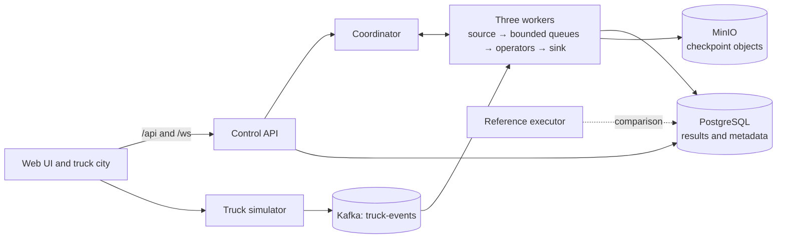

# AetherStream

AetherStream is a stream-processing project for logistics events. It is designed as a small, educational Apache Flink-style engine: it compiles a visual pipeline and processes continuous data across workers, with explicit event-time and recovery behavior.

Its game-like truck-city view gives the data a visible source: simulated trucks move through a delivery city and send position and delivery events into the engine. The city is an orientation layer; the panels and controls are where an operator inspects results and engine state. The UI and engine are still being assembled, so features marked **(in progress)** are contracts or planned demo capabilities, not claims of a verified end-to-end release.

## Features

- Pipeline compiler with collected, plain-English validation errors.
- Per-partition event-time windows and explicit handling of late events.
- Per-key/window event deduplication.
- Configurable rules, including the stuck-truck demonstration.
- Three Compose worker services.
- Bounded queues and observable backpressure.
- Aligned barrier checkpoints stored in MinIO.
- Worker-kill recovery from completed checkpoints with generation fencing.
- Compare distributed results with the deterministic reference executor.
- GitHub Actions build, test, image-build, and Compose checks; published-image deployment to a self-hosted runner **(in progress; no CD workflow is present yet)**.
- Custom Docker images for the engine, simulator, control API, and web UI.

The engine semantics and system integrations are **(in progress)** where they are not implemented and exercised end to end. See the contracts for the intended behavior; they are specifications, not test evidence.

## Architecture



See the [architecture document](docs/architecture.md) **(in progress)** and the [stack and layout contract](docs/contracts/00-stack-and-layout.md) for the current service and module boundaries.

## Repository layout

| Path | Responsibility |
| --- | --- |
| `common/` | Shared Java event, pipeline, protocol, and API records (`:common`) |
| `compiler/` | Pipeline validation, planning, and shared operator semantics (`:compiler`) |
| `reference/` | Deterministic single-process executor (`:reference`) |
| `engine/` | Coordinator and worker runtime (`:engine`) |
| `control-api/` | Spring Boot REST and WebSocket API (`:control-api`) |
| `simulator/` | Truck-city event generator (`:simulator`) |
| `web/` | React, TypeScript, and Vite interface |
| `tests/` | Testcontainers integration and fault tests (`:tests`) |
| `docs/contracts/` | Normative event, pipeline, runtime, and API contracts |
| `docs/ux/` | UX design proposals and assumptions |
| `infra/` | Dockerfiles, database schema, and Compose smoke script |
| `.github/workflows/` | GitHub Actions workflows currently present |

## Quick start

Requirements: Docker with Compose, Java 21, Gradle wrapper, and Node.js 22 for web tests.

```sh
docker compose up -d --build
```

Open [http://localhost:8088](http://localhost:8088). The first build downloads dependencies and builds the application images. Compose defines the complete local stack, including Kafka, PostgreSQL, MinIO, coordinator, three workers, simulator, control API, and web UI.

### Ports

| Service | Host port(s) | Purpose |
| --- | ---: | --- |
| Web UI | `8088` | Browser entry point; proxies `/api` and `/ws` |
| Control API | `18080` | REST API |
| Coordinator | `18081` | Coordinator health and state API |
| Simulator | `18070` | Simulator API |
| Kafka | `19092` | Host-side Kafka listener |
| PostgreSQL | `15432` | Application database |
| MinIO | `19000`, `19001` | S3 API and console |
| Workers 1–3 | — | Internal worker health on container port `8090` |

The default Compose credentials are for local development only; do not expose this stack publicly with defaults.

## Tests

From the repository root, run the Java build and Testcontainers integration suite:

```sh
./gradlew build
./gradlew :tests:integrationTest
```

For the web package:

```sh
cd web
npm ci && npm test
```

Integration tests require a working Docker daemon. The web CI workflow also runs lint and a production build.

## CI/CD workflows

These describe workflow files present in `.github/workflows/`, not a promise that a run has passed. The integration workflow, end-to-end workflow, and deployment workflow described in the project contracts are **(in progress; absent from this checkout)**.

| Workflow | What it checks |
| --- | --- |
| `ci-java.yml` (`ci-java`) | `./gradlew build`: compiles modules and runs Java unit tests; uploads test reports. |
| `ci-web.yml` (`ci-web`) | Installs locked Node dependencies, runs lint and web tests, builds the production UI, and uploads `web/dist`. |
| `ci-images.yml` (`ci-images`) | Builds custom engine, simulator, control API, and web images; smoke-checks Java images and revision labels. |
| `ci-compose.yml` (`ci-compose`) | Builds and starts the Compose stack, runs `infra/scripts/smoke.sh`, records status/logs, then tears down. |
| `ci-integration.yml`, `ci-e2e.yml`, `cd.yml` | **(in progress)** Not present in `.github/workflows/`; integration/recovery automation, browser end-to-end tests, and self-hosted deployment are not claimed as active workflows. |

## Technology stack

| Area | Technology |
| --- | --- |
| Engine and services | Java 21, Gradle 9.6, Spring Boot 3.5 (control API) |
| Event transport | Apache Kafka 4.3.2 |
| Metadata and result sink | PostgreSQL 17 |
| Checkpoint object storage | MinIO (S3-compatible) |
| Web interface | React 19, TypeScript 5.9, Vite 7, PixiJS 8, `@xyflow/react` 12 |
| Local orchestration | Docker Compose |
| CI | GitHub Actions |

Versions follow `docs/contracts/00-stack-and-layout.md` and the dependency catalog; integrations and runtime behavior are still being verified.

## Team and course context

AetherStream is a Collaborative Development and DevOps (CDD) course project for the faculty expo scheduled for **21 November 2026**. The repository does not identify a complete team roster. Add the actual team names and any public demo URL before presenting; do not infer them from this README.

## License

Proprietary. See [LICENSE](LICENSE). All rights reserved.
