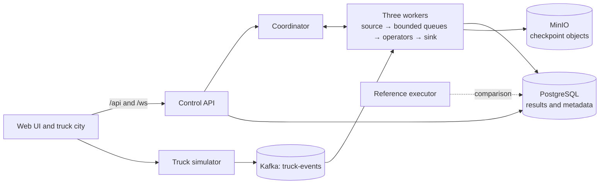

# AetherStream
[](https://github.com/VivekTiwary-25/AetherStream/actions/workflows/ci-java.yml) [](https://github.com/VivekTiwary-25/AetherStream/actions/workflows/ci-web.yml) [](https://github.com/VivekTiwary-25/AetherStream/actions/workflows/ci-integration.yml) [](https://github.com/VivekTiwary-25/AetherStream/actions/workflows/ci-mock.yml) [](https://github.com/VivekTiwary-25/AetherStream/actions/workflows/ci-images.yml) [](https://github.com/VivekTiwary-25/AetherStream/actions/workflows/ci-compose.yml) [](https://github.com/VivekTiwary-25/AetherStream/actions/workflows/ci-e2e.yml) [](https://github.com/VivekTiwary-25/AetherStream/actions/workflows/ci-ui-e2e.yml) [](https://github.com/VivekTiwary-25/AetherStream/actions/workflows/ci-k8s.yml) [](https://github.com/VivekTiwary-25/AetherStream/actions/workflows/ci-terraform.yml) [](https://github.com/VivekTiwary-25/AetherStream/actions/workflows/bench.yml) [](https://github.com/VivekTiwary-25/AetherStream/actions/workflows/cd.yml)
[CI/CD workflow definitions and run evidence](docs/report/ci-cd-evidence.md)


AetherStream is a stream-processing project for logistics events. It is designed as a small, educational Apache Flink-style engine: it compiles a visual pipeline and processes continuous data across workers, with explicit event-time and recovery behavior.

Its game-like truck-city view gives the data a visible source: simulated trucks move through a delivery city and send position and delivery events into the engine. The city is an orientation layer; the panels and controls are where an operator inspects results and engine state. The dashboard shell shows the city and the live panels. The pipeline editor, chaos controls, compare panel, scenario buttons, and checkpoint timeline exist as components, but `web/src/app/shell/AppShell.tsx` does not mount them. A feature marked **(in progress)** is not something you can click in that shell, and a workflow file is not a green run.

## Features

- Pipeline compiler with collected, plain-English validation errors.
- Per-partition event-time windows and explicit handling of late events.
- Per-key/window event deduplication.
- Configurable rules, including the stuck-truck demonstration.
- Three Compose worker services.
- Bounded queues and observable backpressure.
- Aligned barrier checkpoints stored in MinIO.
- Worker-kill recovery from completed checkpoints with generation fencing.
- Compare distributed results with the deterministic reference executor (`POST /api/compare`).
- Savepoints and restore (`POST /api/executions/{id}/savepoints`, `GET /api/savepoints`, `POST /api/executions/{id}/restore`). An incompatible savepoint is rejected.
- Rescale as a controlled pause at a completed checkpoint, then reassignment (`POST /api/executions/{id}/rescale`). This is not online migration. A balanced assignment is refused.
- Simulator scenarios (`GET /api/scenarios`, `POST /api/simulator/scenario`): Rush hour, Breakdown, Surge, and Reset. The scenario buttons are in `web/src/app/scenarios/ScenarioPanel.tsx` and are not mounted in the shell.
- Example pipelines (`GET /api/pipelines/examples`), including `logistics-demo`, `speeding-alerts`, `fleet-activity`, and `broken-for-demo`.
- Checkpoint timeline component at `web/src/app/timeline/CheckpointTimeline.tsx` **(in progress as a shell control; the component is not mounted)**.
- Optional Prometheus and Grafana Compose profile (`infra/monitoring`).
- Kubernetes manifests with kind CI (`infra/kubernetes`, `.github/workflows/ci-k8s.yml`).
- Local Terraform for Docker (`infra/terraform`, `.github/workflows/ci-terraform.yml`).
- GitHub Actions for Java, web, images, Compose smoke, integration tests, the full-system demo, kind, Terraform, benchmarks, and a self-hosted Compose deploy (`.github/workflows/cd.yml`).

The engine semantics and system integrations are **(in progress)** where they are not implemented and exercised end to end. See the contracts for the intended behavior; they are specifications, not test evidence.

## Architecture



See the [architecture document](docs/architecture.md) and the [stack and layout contract](docs/contracts/00-stack-and-layout.md) for the current service and module boundaries.

## Repository layout

| Path | Responsibility |
| --- | --- |
| `common/` | Shared Java event, pipeline, protocol, and API records (`:common`) |
| `compiler/` | Pipeline validation, planning, and shared operator semantics (`:compiler`) |
| `reference/` | Deterministic single-process executor (`:reference`) |
| `engine/` | Coordinator and worker runtime (`:engine`) |
| `control-api/` | Spring Boot REST and WebSocket API (`:control-api`) |
| `simulator/` | Truck-city event generator (`:simulator`) |
| `web/` | React, TypeScript, and Vite interface |
| `tests/` | Testcontainers integration and fault tests (`:tests`) |
| `docs/contracts/` | Normative event, pipeline, runtime, and API contracts |
| `docs/ux/` | UX design proposals and assumptions |
| `infra/` | Dockerfiles, Compose, the monitoring profile, Kubernetes manifests, Terraform, and demo scripts |
| `.github/workflows/` | GitHub Actions workflows currently on `main` |

## Quick start

Requirements: Docker with Compose, Java 21, Gradle wrapper, and Node.js 22 for web tests.

```sh
docker compose up -d --build
```

Open [http://localhost:8088](http://localhost:8088). The first build downloads dependencies and builds the application images. Compose defines the complete local stack, including Kafka, PostgreSQL, MinIO, coordinator, three workers, simulator, control API, and web UI. Prometheus and Grafana are not in that default set. Start them with `docker compose --profile monitoring up -d`, then open Grafana at [http://localhost:13000](http://localhost:13000) (dashboard **AetherStream engine**) and Prometheus at [http://localhost:19090](http://localhost:19090). See [infra/monitoring/README.md](infra/monitoring/README.md).

### Ports

| Service | Host port(s) | Purpose |
| --- | ---: | --- |
| Web UI | `8088` | Browser entry point; proxies `/api` and `/ws` |
| Control API | `18080` | REST API |
| Coordinator | `18081` | Coordinator health and state API |
| Simulator | `18070` | Simulator API |
| Kafka | `19092` | Host-side Kafka listener |
| PostgreSQL | `15432` | Application database |
| MinIO | `19000`, `19001` | S3 API and console |
| Workers 1–3 | — | Internal worker health on container port `8090` |
| Prometheus | `19090` | Only with Compose profile `monitoring` |
| Grafana | `13000` | Only with Compose profile `monitoring` |

The default Compose credentials are for local development only; do not expose this stack publicly with defaults.

## Tests

From the repository root, run the Java build and Testcontainers integration suite:

```sh
./gradlew build
./gradlew :tests:integrationTest
```

For the web package:

```sh
cd web
npm ci && npm test
```

Integration tests require a working Docker daemon. The web CI workflow also runs lint and a production build. `tests/src/test/java/io/aetherstream/tests/WorkerAdaptersIT.java` covers the Kafka source and the Postgres sink, including generation fencing. `tests/src/test/java/io/aetherstream/tests/EngineMatchesReferenceIT.java` compares the engine with the reference executor. Actions run [44395770221](https://github.com/VivekTiwary-25/AetherStream/actions/runs/44395770221) logged that comparison as 811 reference results, 811 engine results, 811 matched, and dead letters 25 and 25 equal. That is one run's log, not a promise that a later run printed the same counts.

## CI/CD workflows

These describe workflow files present in `.github/workflows/` on `main`. A file is the design of the check. Open the Actions log before calling a run green. Trigger and path-filter detail is in [docs/ci-cd.md](docs/ci-cd.md).

| Workflow | What it checks |
| --- | --- |
| `ci-java.yml` (`ci-java`) | `./gradlew build`: compiles modules and runs Java unit tests; uploads test reports. |
| `ci-web.yml` (`ci-web`) | Installs locked Node dependencies, runs lint and web tests, builds the production UI, and uploads `web/dist`. |
| `ci-integration.yml` (`ci-integration`) | `./gradlew :tests:integrationTest` with Testcontainers. |
| `ci-images.yml` (`ci-images`) | Builds custom engine, simulator, control API, and web images; smoke-checks Java images and revision labels. |
| `ci-compose.yml` (`ci-compose`) | Builds and starts the Compose stack, runs `infra/scripts/smoke.sh`, records status/logs, then tears down. |
| `ci-e2e.yml` (`ci-e2e`) | Lints `infra/scripts/demo-e2e.sh`, then runs that full-system Compose demo. The demo job is blocking. |
| `ci-k8s.yml` (`ci-k8s`) | Renders `infra/kubernetes`, starts a kind cluster, and always dumps `kubectl get pods -A -o wide`. |
| `ci-terraform.yml` (`ci-terraform`) | Formats and validates `infra/terraform`, then apply, readiness, and destroy. The apply log includes the plan. |
| `bench.yml` (`bench`) | `./gradlew :tests:benchmarkTest`. This README does not quote benchmark numbers. |
| `ci-ui-e2e.yml` (`ci-ui-e2e`) | Playwright demo in `tests/ui` against Compose. The job is `continue-on-error: true` because the editor, chaos, and compare surfaces are not in the shell. |
| `ci-mock.yml` (`ci-mock`) | Dev mock server smoke test. |
| `cd.yml` (`cd`) | On `main`, publishes GHCR images tagged with the commit SHA and deploys Compose on the self-hosted runner labelled `aether-deploy`. |

## Technology stack

| Area | Technology |
| --- | --- |
| Engine and services | Java 21, Gradle 9.6, Spring Boot 3.5 (control API) |
| Event transport | Apache Kafka 4.3.2 |
| Metadata and result sink | PostgreSQL 17 |
| Checkpoint object storage | MinIO (S3-compatible) |
| Web interface | React 19, TypeScript 5.9, Vite 7, PixiJS 8, `@xyflow/react` 12 |
| Local orchestration | Docker Compose. Kubernetes manifests and Terraform are extra demo/CI paths, not a replacement for Compose. |
| CI | GitHub Actions |
| Metrics (optional) | Prometheus and Grafana, Compose profile `monitoring` |

Versions follow `docs/contracts/00-stack-and-layout.md` and the dependency catalog; integrations and runtime behavior are still being verified.

## Team and course context

AetherStream is a Collaborative Development and DevOps (CDD) course project for the faculty expo scheduled for **21 November 2026**. The repository does not identify a complete team roster. Add the actual team names and any public demo URL before presenting; do not infer them from this README.

## License

Proprietary. See [LICENSE](LICENSE). All rights reserved.
