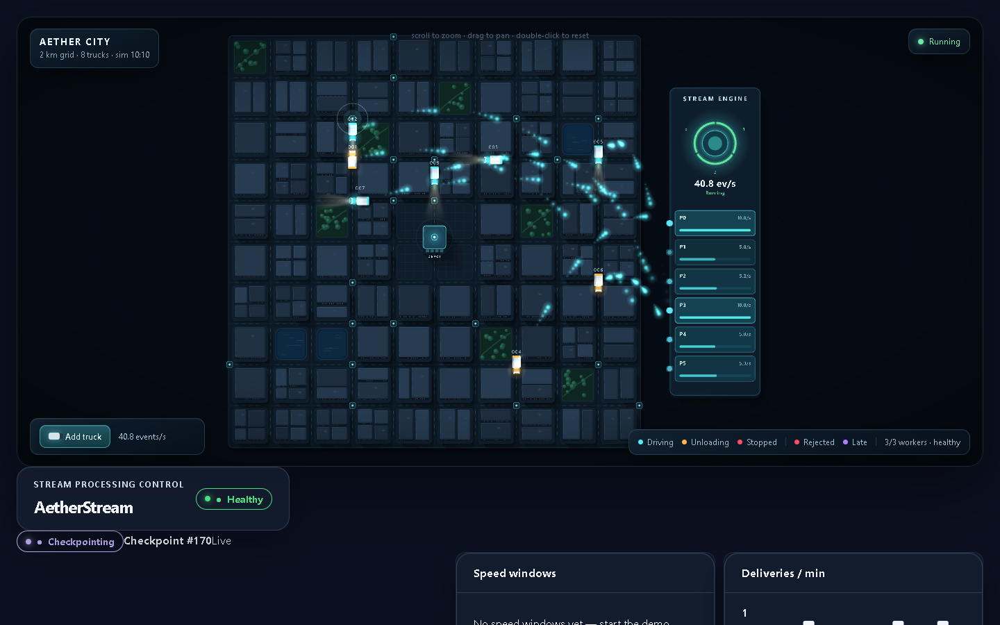

# AetherStream

[](https://github.com/VivekTiwary-25/AetherStream/actions/workflows/ci-java.yml) [](https://github.com/VivekTiwary-25/AetherStream/actions/workflows/ci-web.yml) [](https://github.com/VivekTiwary-25/AetherStream/actions/workflows/ci-integration.yml) [](https://github.com/VivekTiwary-25/AetherStream/actions/workflows/ci-mock.yml) [](https://github.com/VivekTiwary-25/AetherStream/actions/workflows/ci-images.yml) [](https://github.com/VivekTiwary-25/AetherStream/actions/workflows/ci-compose.yml) [](https://github.com/VivekTiwary-25/AetherStream/actions/workflows/ci-e2e.yml) [](https://github.com/VivekTiwary-25/AetherStream/actions/workflows/ci-ui-e2e.yml) [](https://github.com/VivekTiwary-25/AetherStream/actions/workflows/ci-k8s.yml) [](https://github.com/VivekTiwary-25/AetherStream/actions/workflows/ci-terraform.yml) [](https://github.com/VivekTiwary-25/AetherStream/actions/workflows/bench.yml) [](https://github.com/VivekTiwary-25/AetherStream/actions/workflows/cd.yml)

[CI/CD workflow definitions and run evidence](docs/report/ci-cd-evidence.md)

AetherStream is a fault-tolerant distributed stream processor, a mini Apache Flink, with a game-like truck city UI. Simulated trucks drive a delivery city and emit position and delivery events onto a six-partition Kafka topic; three workers compute event-time windows and alerts, upsert results to Postgres, and take aligned checkpoints in MinIO so a killed worker can be restored from the last completed checkpoint and fenced off the sink. The city is the visible source of the stream; the panels are where you read what the engine wrote.



## Features

- Truck city (PixiJS): simulated trucks on a 2 km grid, with a live events/s stream into the engine (`web/src/city/`, mounted in `web/src/app/shell/AppShell.tsx`).
- Pipeline editor: draw source, filter, map, key-by, window, rule, and sink nodes; validate in plain English; load `logistics-demo`, `speeding-alerts`, `fleet-activity`, or `broken-for-demo`; run.
- Live panels: speed windows, deliveries per minute, alerts, workers, and dead letters.
- Chaos controls: send late events, duplicates, or malformed records; slow the sink; kill a worker (real halt, then recovery).
- Reference comparison: one-process replay of the checkpointed Kafka range, matched to Postgres (`POST /api/compare`).
- Checkpoint and recovery timeline, including recovering-from-checkpoint and recovered text.
- Operations: take a savepoint, restore from it, or rescale (pause at the next checkpoint and reassign; not live migration).
- City scenarios: Rush hour, Breakdown, Surge, and Reset.
- Presenter tour (eight steps) and intro splash.
- Status as text and colour: running, backpressured, checkpointing, recovering, stopped, and failed.
- Three Compose workers, each a source thread, operator thread, and sink thread, with two bounded queues of capacity 1000; a full queue blocks the stage above it.
- Aligned barrier checkpoints in MinIO; restore uses only the latest completed checkpoint; a generation fence stops a stale worker from committing.
- Event-time tumbling windows, late events as dead letters, and per-key/window dedup of `eventId` (operator code in `:compiler`, run by the engine).
- Demo pipeline stuck-truck rule (`logistics-demo`): average speed under 1 for 10 one-minute windows.

## Architecture

The browser never talks to Kafka, the workers, or MinIO. nginx serves the UI and proxies `/api` and `/ws` to the control API. The control API validates a pipeline and asks the coordinator to run it. The simulator writes truck events to Kafka topic `truck-events` (6 partitions, keyed by truck). Three workers consume assigned partitions, run the shared operators, and upsert window results, alerts, and dead letters to Postgres. The coordinator is not on the record path: it assigns partitions, triggers aligned barrier checkpoints, and on worker death restores every partition from the latest completed checkpoint in MinIO, then replays Kafka from the saved offsets. The same operator code runs in a single-process reference executor, which is what "Compare with reference" checks. Apache Flink is the design reference, not the runtime.


See [docs/architecture.md](docs/architecture.md).

## Quick start

Docker with Compose is required. From the repo root, if the stack is not already the live demo:

```sh
docker compose up -d --build
docker compose --profile monitoring up -d
```

Do not run `docker compose down -v` on a machine that is already hosting the live demo.

```sh
docker compose ps
```

Application services should be healthy. `kafka-init` and `minio-init` should be exited, not running. Open [http://localhost:8088](http://localhost:8088). With the monitoring profile, Grafana is [http://localhost:13000](http://localhost:13000) (dashboard **AetherStream engine**) and Prometheus is [http://localhost:19090](http://localhost:19090).

| Service | Host port |
| --- | ---: |
| Web UI | 8088 |
| Control API | 18080 |
| Coordinator | 18081 |
| Simulator | 18070 |
| Kafka | 19092 |
| PostgreSQL | 15432 |
| MinIO API, console | 19000, 19001 |
| Prometheus (`monitoring` profile) | 19090 |
| Grafana (`monitoring` profile) | 13000 |

Workers 1–3 publish no host port. Default Compose credentials are for local development only.

## Tests

Commands below are the `run:` lines in `.github/workflows/`. Java 21 and the Gradle wrapper for Gradle commands; Node.js 22 for the web and UI jobs. Integration and end-to-end jobs need a Docker daemon.

Unit — `.github/workflows/ci-java.yml`:

```sh
./gradlew build --console=plain
```

Web — `.github/workflows/ci-web.yml`, working directory `web/`:

```sh
npm ci
npm run lint
npm run test
npm run build
```

Integration — `.github/workflows/ci-integration.yml`:

```sh
./gradlew :tests:integrationTest --console=plain
```

End-to-end — `.github/workflows/ci-e2e.yml`. Compose step, then the demo script:

```sh
docker compose up -d --build
bash infra/scripts/demo-e2e.sh
```

That workflow sets `GIT_SHA` on the compose step and `EXPECT_SHA` plus `E2E_EXTENDED=1` on the script, both to the commit SHA. If `EXPECT_SHA` is unset, the script still runs and skips the commit check.

UI end-to-end — `.github/workflows/ci-ui-e2e.yml`. Compose from the repo root, npm from `tests/ui`:

```sh
GIT_SHA=${{ github.sha }} docker compose up -d --build --wait
npm install --package-lock=false --no-audit --no-fund
npx playwright install --with-deps chromium
npm test
```

`${{ github.sha }}` is the Actions expression for the commit. The `npm test` step also sets `EXPECT_SHA` to that commit.

## CI/CD

`.github/workflows/` has one workflow per concern: Java unit tests (`./gradlew build --console=plain`), web lint/test/build, Testcontainers integration, the dev mock smoke (`cd web/mock && npm install && node smoke.mjs`), image builds, Compose smoke (`docker compose up -d --build` then `bash infra/scripts/smoke.sh`), the full-system demo (`bash infra/scripts/demo-e2e.sh`), a Playwright UI demo, kind, Terraform, benchmarks (`./gradlew :tests:benchmarkTest --console=plain`), and CD. On a push to `main`, `cd.yml` publishes the engine, simulator, control-api, and web images to GHCR tagged with the commit SHA, then deploys that SHA on the self-hosted runner labelled `aether-deploy`. A workflow file is not a green run.

[CI/CD workflow definitions and run evidence](docs/report/ci-cd-evidence.md)

## Repository layout

| Path | What |
| --- | --- |
| `.github/` | GitHub Actions workflows |
| `benchmarks/` | Benchmark measurement notes; the Gradle task is `:tests:benchmarkTest` |
| `common/` | Shared Java records for the envelope, pipeline, protocol, and API |
| `compiler/` | Pipeline validation, planning, and operator semantics |
| `control-api/` | Spring Boot REST and WebSocket API |
| `docs/` | Contracts, architecture, UX, and the course report |
| `engine/` | Coordinator and worker runtime |
| `gradle/` | Wrapper and version catalog |
| `infra/` | Dockerfiles, Compose, monitoring profile, Kubernetes, Terraform, and scripts |
| `reference/` | Deterministic single-process reference executor |
| `simulator/` | Truck-city event generator |
| `tests/` | Testcontainers integration and fault tests, plus Playwright UI tests |
| `web/` | React, TypeScript, and Vite UI, plus the dev mock server |

## Team

Collaborative Development and DevOps (CDD) course project, faculty expo 21 November 2026. This repository does not name the team.

## Further reading

- [DEMO.md](DEMO.md) — examiner demo script
- [Project report](docs/report/project-report.md)
- [UX](docs/ux/README.md) — notes and screenshots under [docs/ux/](docs/ux/)

## License

Proprietary. See [LICENSE](LICENSE).
