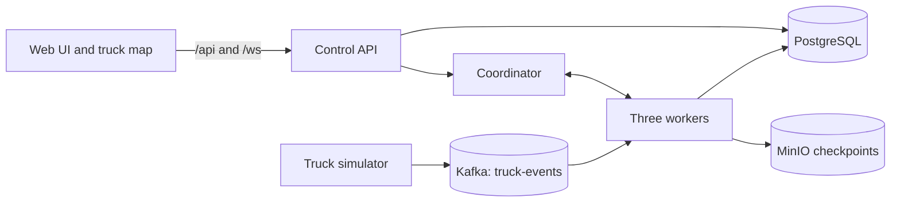

# AetherStream

[](https://github.com/VivekTiwary-25/AetherStream/actions/workflows/ci-java.yml) [](https://github.com/VivekTiwary-25/AetherStream/actions/workflows/ci-web.yml) [](https://github.com/VivekTiwary-25/AetherStream/actions/workflows/ci-integration.yml) [](https://github.com/VivekTiwary-25/AetherStream/actions/workflows/ci-mock.yml) [](https://github.com/VivekTiwary-25/AetherStream/actions/workflows/ci-images.yml) [](https://github.com/VivekTiwary-25/AetherStream/actions/workflows/ci-compose.yml) [](https://github.com/VivekTiwary-25/AetherStream/actions/workflows/ci-e2e.yml) [](https://github.com/VivekTiwary-25/AetherStream/actions/workflows/ci-ui-e2e.yml) [](https://github.com/VivekTiwary-25/AetherStream/actions/workflows/ci-k8s.yml) [](https://github.com/VivekTiwary-25/AetherStream/actions/workflows/ci-terraform.yml) [](https://github.com/VivekTiwary-25/AetherStream/actions/workflows/bench.yml) [](https://github.com/VivekTiwary-25/AetherStream/actions/workflows/cd.yml) [](https://github.com/VivekTiwary-25/AetherStream/actions/workflows/ci-docs.yml) [](https://github.com/VivekTiwary-25/AetherStream/actions/workflows/ci-coldstart.yml)

[CI/CD workflow definitions and run evidence](docs/report/ci-cd-evidence.md)

AetherStream is a fault-tolerant distributed stream processor—a mini Apache Flink—with a live Mysuru truck map. Six configured trucks produce position and delivery events for a six-partition Kafka topic; three workers process event-time windows and alerts, store results in Postgres, and checkpoint state to MinIO. If a worker fails, the coordinator restores its work from the latest completed checkpoint and replays Kafka from saved offsets. The map shows the live fleet; analytics and recovery views expose what the engine is doing.

## The UI

The default `ui-glorious` UI has **Home** with a live status pill, **Live World** with a real Mysuru map and live trucks, **Analytics**, **Pipelines**, and **Settings**. Hover or focus a truck on the map to see its card, including its partition and worker assignment. **Analytics** contains **Truck Speeds**, **Deliveries**, **Alerts**, **Events Processed**, and **Failed Records**. In **Pipelines**, enter a prompt in **Ask AI**, generate and review a validated pipeline, open it in the editor, click **Run**, and inspect **Pipeline results**. If AI is offline, the UI labels saved examples as such. **Settings** contains **Logs & Recovery** and **Truck Breakdown**. The classic UI remains available at `?ui=classic`.

Run `npm run check:no-mock` from `web/` to scan the production build for mock-only markers.

## Architecture

The browser never talks to Kafka, the workers, or MinIO. nginx serves the UI and proxies `/api` and `/ws` to the Spring Boot control API. The API validates a pipeline and asks the coordinator to run it. The simulator writes truck events to the six-partition Kafka topic `truck-events`, keyed by truck. Three workers consume assigned partitions, run the shared operators, and upsert window results, alerts, and failed records to Postgres. The coordinator is not on the record path: it assigns partitions, triggers aligned barrier checkpoints, and on worker death restores the affected work from the latest completed checkpoint in MinIO, then replays Kafka from saved offsets. The same operator code runs in a single-process reference executor for comparison with Postgres.



See [docs/architecture.md](docs/architecture.md).

## Tech stack and why

| Technology | What it is | Why we use it |
| --- | --- | --- |
| Kafka | Six-partition `truck-events` topic | Durable, replayable stream input |
| Java workers + coordinator | Distributed runtime | Processes partitions and coordinates checkpoints and recovery |
| Postgres | Metadata and result store | Persists executions, checkpoints, and pipeline outputs |
| MinIO | S3-compatible checkpoint storage | Stores worker snapshots and checkpoint manifests |
| Spring Boot control API | REST and WebSocket service | Connects the UI to pipeline validation, execution, and results |
| nginx | Web server and reverse proxy | Serves the UI and proxies `/api` and `/ws` |
| React + Vite + MapLibre | Web UI and map renderer | Builds the interactive UI and real Mysuru map |
| Ask AI (Claude via local bridge on port 18090) | Optional local Claude Code integration | Generates pipeline drafts; labelled saved examples remain available offline |
| Docker Compose | Local multi-service runtime | Starts the app and its infrastructure together |
| GitHub Actions + GHCR | CI workflows and container registry | Tests and builds in Actions; publishes SHA-tagged images from `main` |
| Prometheus + Grafana | Optional Compose monitoring profile | Scrapes service metrics and displays the AetherStream engine dashboard |
| Kubernetes (kind) + Terraform in CI | Deployment definitions and CI validation | Checks Kubernetes manifests in kind and validates/applies Terraform in CI |
| Testcontainers + Playwright | Integration and browser test tools | Exercises services with containers and the UI in a browser |

## How the demo works

1. **Home:** show the navigation and live status pill.
2. **Live World:** open the real Mysuru map and observe live truck markers.
3. **Truck card:** hover or focus a marker to see telemetry and partition/worker assignment.
4. **Truck Breakdown:** confirm a breakdown and observe the resulting stuck-truck alert.
5. **Truck Speeds:** open **Analytics** → **Truck Speeds**.
6. **Failed Records:** run `events late 10` once, then open **Analytics** → **Failed Records**. Records appear only if the engine classifies them as late.
7. **Ask AI:** enter `Alert me when any truck goes over 45 km/h`, click **Generate**, review, **Open in editor**, then click **Run** and inspect **Pipeline results**. If AI is offline, use only the clearly labelled saved example.
8. **Recovery:** run `worker kill 2` once and observe **Dead**, restoration from a completed checkpoint, then **Rejoined**. The worker keeps its own partitions; recovery does not reassign them.

See the [full new-UI expo script](docs/expo/DEMO-NEW-UI.md) for the detailed run of show and conditions.

## Verified live vs offline

Statuses below follow [design/ui-glorious/DONE-CHECKLIST.md](design/ui-glorious/DONE-CHECKLIST.md); they are scoped evidence, not a claim that every UI path is verified.

| Status in checklist | Evidence area |
| --- | --- |
| **VERIFIED-LIVE** | Live World map and truck card; Truck Speeds; Failed Records; selected navigation and drill-down smoke checks |
| **VERIFIED-OFFLINE** | Recovery history attribution and checkpoint restore test; API-down polling; recovery visual polish |
| **PARTIAL - fix in progress** | Ask AI/pipeline run results and worker recovery display; one sample pipeline produced real results, and the survivor “Rejoined” label is unreliable |
| **UNVERIFIED** | Home video playback/loop; full seven-step demo end to end; app-wide absence of fake data |
| **VERIFIED — BRIDGE EVALUATION** | Ask AI prompt evaluation against the local bridge; this does not verify app Run/results |

The worker restart is about 2 seconds, before the 4-second heartbeat timeout, so it keeps its own partitions; there is no reassignment. With the six truck keys, partition 1 receives no events and P4 gets two. These are the observed demo setup details, not a guarantee for other keys or configurations.


## Quick start

Docker with Compose is required. From the repo root, if the stack is not already the live demo:

```sh
docker compose up -d --build
docker compose --profile monitoring up -d
```

Do not run `docker compose down -v` on a machine that is already hosting the live demo.

```sh
docker compose ps
```

Application services should be healthy. `kafka-init` and `minio-init` should be exited, not running. Open [http://localhost:8088](http://localhost:8088). With the monitoring profile, Grafana is [http://localhost:13000](http://localhost:13000) (dashboard **AetherStream engine**) and Prometheus is [http://localhost:19090](http://localhost:19090).

| Service | Host port |
| --- | ---: |
| Web UI | 8088 |
| Control API | 18080 |
| Coordinator | 18081 |
| Simulator | 18070 |
| Kafka | 19092 |
| PostgreSQL | 15432 |
| MinIO API, console | 19000, 19001 |
| Prometheus (`monitoring` profile) | 19090 |
| Grafana (`monitoring` profile) | 13000 |

Workers 1–3 publish no host port. Default Compose credentials are for local development only.

### Full UI stack on Windows

From the repository root, start the separate preview stack:

```powershell
powershell -NoProfile -ExecutionPolicy Bypass -File scripts/preview/preview-up.ps1
```

The script prepares its preview checkout, builds and starts the full Compose stack under a separate project on port `8089`, and starts a Cloudflare quick tunnel. Its generated tunnel URL is saved in `C:\aether-preview\.preview\url.txt`; do not publish that URL. Some networks block the tunnel. In that case, open [http://localhost:8089](http://localhost:8089).

### Ask AI bridge

On the same PC, start the local bridge from the repository root:

```powershell
powershell -ExecutionPolicy Bypass -File scripts/ai-bridge/start.ps1
```

The PC needs Python 3.10+, Claude Code installed, and a logged-in Claude Code session. The bridge listens on `127.0.0.1:18090`. Without a working bridge or login, Ask AI shows its honest offline state and labelled saved examples; do not describe those examples as AI-generated.

## Tests

Commands below are the `run:` lines in `.github/workflows/`. Java 21 and the Gradle wrapper for Gradle commands; Node.js 22 for the web and UI jobs. Integration and end-to-end jobs need a Docker daemon.

Unit — `.github/workflows/ci-java.yml`:

```sh
./gradlew build --console=plain
```

Web — `.github/workflows/ci-web.yml`, working directory `web/`:

```sh
npm ci
npm run lint
npm run test
npm run build
```

Integration — `.github/workflows/ci-integration.yml`:

```sh
./gradlew :tests:integrationTest --console=plain
```

End-to-end — `.github/workflows/ci-e2e.yml`. Compose step, then the demo script:

```sh
docker compose up -d --build
bash infra/scripts/demo-e2e.sh
```

That workflow sets `GIT_SHA` on the compose step and `EXPECT_SHA` plus `E2E_EXTENDED=1` on the script, both to the commit SHA. If `EXPECT_SHA` is unset, the script still runs and skips the commit check.

UI end-to-end — `.github/workflows/ci-ui-e2e.yml`. Compose from the repo root, npm from `tests/ui`:

```sh
GIT_SHA=${{ github.sha }} docker compose up -d --build --wait
npm install --package-lock=false --no-audit --no-fund
npx playwright install --with-deps chromium
npm test
```

`${{ github.sha }}` is the Actions expression for the commit. The `npm test` step also sets `EXPECT_SHA` to that commit.

## CI/CD

`.github/workflows/` has one workflow per concern: Java unit tests (`./gradlew build --console=plain`), web lint/test/build, Testcontainers integration, the dev mock smoke (`cd web/mock && npm install && node smoke.mjs`), image builds, Compose smoke (`docker compose up -d --build` then `bash infra/scripts/smoke.sh`), the full-system demo (`bash infra/scripts/demo-e2e.sh`), the Playwright UI demo, kind, Terraform, monitoring, the scheduled/manual chaos soak (`bash infra/scripts/soak.sh`), benchmarks (`./gradlew :tests:benchmarkTest --console=plain`), and CD. On a push to `main`, `cd.yml` publishes the engine, simulator, control-api, and web images to GHCR tagged with the commit SHA, then deploys that SHA on the self-hosted runner labelled `aether-deploy`. A workflow file is not a green run.

[CI/CD workflow definitions and run evidence](docs/report/ci-cd-evidence.md)

## Repository layout

| Path | What |
| --- | --- |
| `.github/` | GitHub Actions workflows |
| `benchmarks/` | Benchmark measurement notes; the Gradle task is `:tests:benchmarkTest` |
| `common/` | Shared Java records for the envelope, pipeline, protocol, and API |
| `compiler/` | Pipeline validation, planning, and operator semantics |
| `control-api/` | Spring Boot REST and WebSocket API |
| `docs/` | Contracts, architecture, UX, and the course report |
| `engine/` | Coordinator and worker runtime |
| `gradle/` | Wrapper and version catalog |
| `infra/` | Dockerfiles, Compose, monitoring profile, Kubernetes, Terraform, and scripts |
| `reference/` | Deterministic single-process reference executor |
| `simulator/` | Truck-city event generator |
| `tests/` | Testcontainers integration and fault tests, plus Playwright UI tests |
| `web/` | React, TypeScript, and Vite UI, plus the dev mock server |
| `web/src/glorious/` | Current `ui-glorious` interface |
| `scripts/expo/` | Expo terminal commands for worker status, worker kill, and late events |
| `scripts/ai-bridge/` | Local Ask AI bridge launcher and implementation |
| `scripts/preview/` | Windows preview stack scripts |

## Team

Collaborative Development and DevOps (CDD) course project, faculty expo 21 November 2026. This repository does not name the team.

## Further reading

- [DEMO.md](DEMO.md) — examiner demo script
- [Project report](docs/report/project-report.md)
- [UX](docs/ux/README.md) — notes and screenshots under [docs/ux/](docs/ux/)

The new default UI (`ui-glorious`) has a [20-minute expo demo](docs/expo/DEMO-NEW-UI.md) and [New UI cheat sheet](docs/expo/CHEATSHEET.md#new-ui-ui-glorious); the classic UI remains available at `?ui=classic`.


## License

Proprietary. See [LICENSE](LICENSE).
