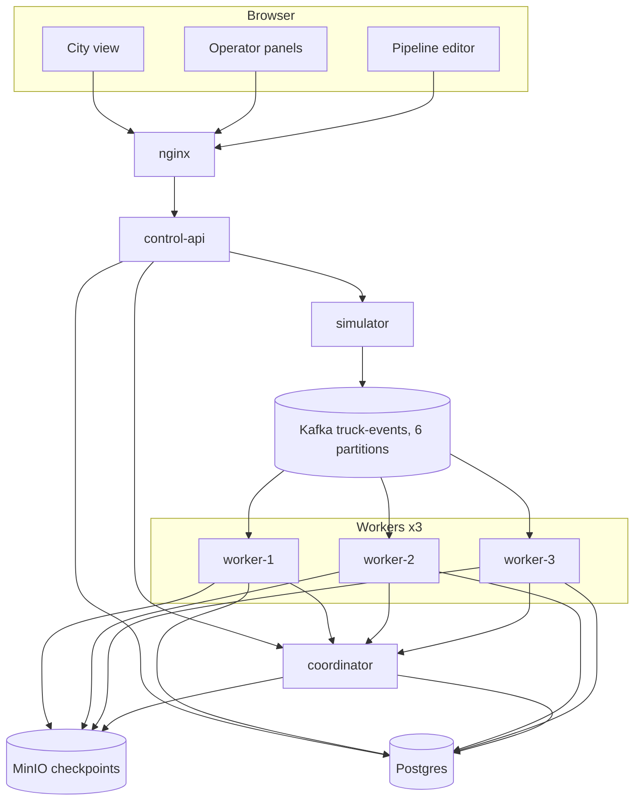
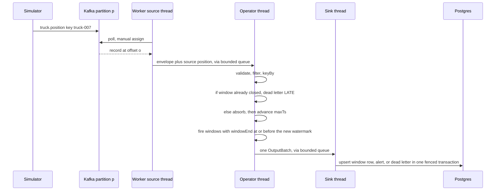
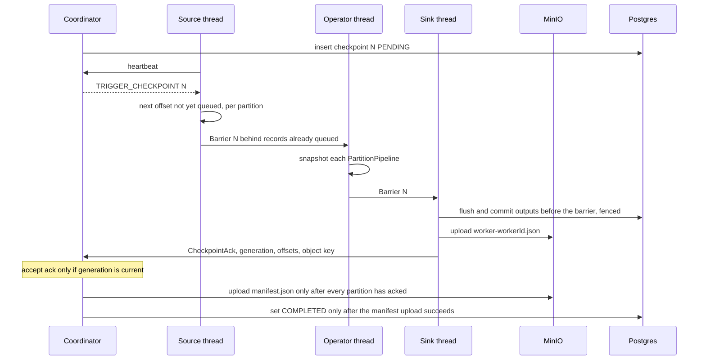
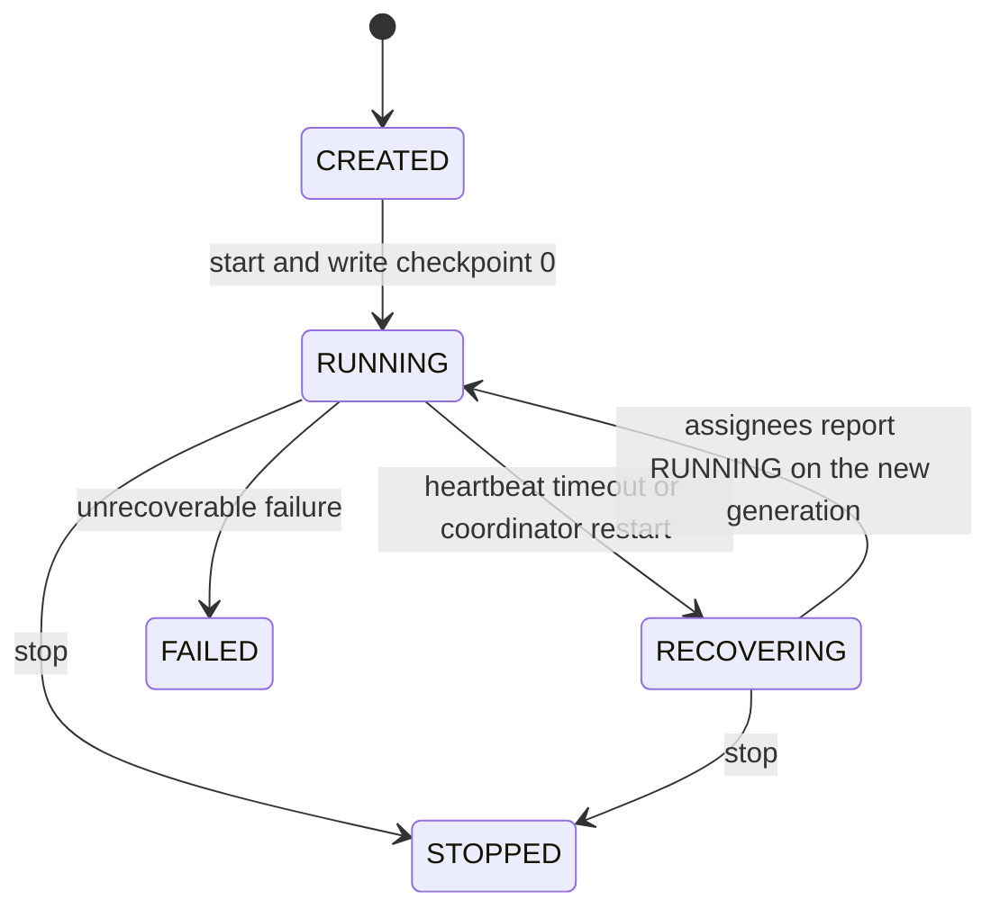
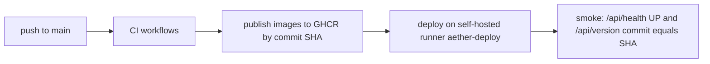

# AetherStream architecture

This document describes the system design an examiner should grade against. The normative design is `docs/contracts/`. Handoff sections 4–10 set the problem and the correctness questions; where the handoff proposed something the contracts did not adopt, this document follows the contracts. Features that are specified as later work, and are not in the v1 contracts, are marked **planned**. This document does not report measured throughput, latency, or checkpoint times.

## 1. Summary

AetherStream is a small distributed stream engine for a simulated logistics city. A user draws a pipeline in the browser. The control API validates it and asks the coordinator to run it. A simulator writes truck events to a 6-partition Kafka topic. Three workers consume those partitions, compute event-time windows and alerts, and upsert results into Postgres. The coordinator detects a dead worker, fences it, and restores every partition from the latest completed checkpoint in MinIO, then replays Kafka from the saved offsets. The same operator code runs in a single-process reference executor, so "Compare with reference" can check the Postgres results for one checkpoint range. Apache Flink is a research reference only. It is not the runtime.



The browser never talks to Kafka, workers, or MinIO. nginx proxies `/api` and `/ws` to control-api. Workers call the coordinator. The coordinator does not open a connection to a worker to send a command.

## 2. Control plane, data plane, and recovery coordination

Three planes share one set of Java records (`:common`) and one operator implementation (`io.aetherstream.compiler.ops`). The engine adds distribution, checkpoints, and recovery around those operators. The reference executor runs the same operators in one process. That is what makes a comparison meaningful: both sides compute the same function.

| Component | Contract 00 module | Plane | Responsibility |
|---|---|---|---|
| Shared records | `:common` | all | Envelope, pipeline, protocol, and API DTOs. JSON field names match record names. Unknown JSON fields are ignored. |
| Compiler | `:compiler` | control, and the operator function used by the data plane | Validate a pipeline JSON graph. Produce a deterministic execution plan. Own operator semantics, used by both engine and reference. |
| Reference executor | `:reference` | check, not the hot path | Replay one offset range per partition in a single process. Used by "Compare with reference". |
| Coordinator | `:engine` (one main class) | recovery coordination | Membership, partition assignment, execution generation (fencing token), checkpoint trigger and completion, failure detection, recovery. State in Postgres `executions` and `checkpoints`. One active instance. |
| Worker | `:engine` (other main class) | data plane | One `PartitionPipeline` per assigned partition. Three threads, two bounded queues. Snapshots and fenced Postgres writes. |
| Control API | `:control-api` | control plane | REST and WebSocket for the UI. Pipeline versions, start and stop, results, chaos proxies, compare. Does not run operators. |
| Simulator | `:simulator` | data plane source | Deterministic truck-city generator. Writes the Kafka topic. HTTP control on port 8070. |
| Web UI | `web/` | control plane | City view (PixiJS), operator panels, pipeline editor (xyflow). Same-origin calls through nginx. |
| Integration tests | `:tests` | check | Fault and integration tests against real Kafka, Postgres, and MinIO containers. |
| Kafka | infrastructure | data plane | Durable, replayable input. Topic `truck-events`, 6 partitions, replication 1. Not the operator runtime. |
| Postgres | infrastructure | control metadata and data-plane sink | Pipeline versions, executions, checkpoints, audit rows, and the only result tables that have a declared output guarantee. |
| MinIO | infrastructure | recovery coordination | Checkpoint worker files and the manifest. S3 API. |
| nginx | infrastructure | control plane edge | Serves the UI and proxies `/api` and `/ws`. |

**Control plane.** The pipeline author edits a graph. The operator watches workers, queues, checkpoints, and failures. The evaluator starts a seeded run and compares it with the reference. An organisation-administrator role, login, and cross-organisation access control are **planned**. They are not in the v1 API.

The control API is the only process the browser calls. It stores pipeline versions in Postgres (`pipelines`, primary key `id, version`; the same id gets the next version). Starting an execution sends the plan to the coordinator. Only one execution is RUNNING at a time; starting another stops the old one. The same idempotency key returns the same execution. A WebSocket pushes trucks, flow, new result rows, worker status, and execution events. The UI must show running, backpressured, checkpointing, recovering, paused or stopped, and failed as text plus colour, not colour alone.

**Data plane.** The simulator is the producer. Workers are the consumers. Postgres result tables are the sink. There is no shuffle stage in v1 (section 10).

**Recovery coordination.** The coordinator is not on the record path. It decides who owns which partitions, when a checkpoint starts, when it is complete, and what to do when a worker disappears. Checkpoint bytes live in MinIO. The decision of which checkpoint is safe to restore lives in the Postgres `checkpoints` row, and only after the manifest upload succeeds.

A metrics stack (Prometheus, Grafana) was proposed in the handoff and is **planned**. v1 exposes health endpoints, queue depths, lag, and records-per-second on the heartbeat and on the WebSocket. Those fields exist so an operator can see backpressure. This document does not treat any sample value as a measurement.

### Services and ports

Compose network name: `aether`.

| Service | Container port | Host port |
|---|---|---|
| kafka | 9092 (`kafka:9092`) | 19092 (`localhost:19092`) |
| postgres | 5432, database `aether` | 15432 |
| minio | 9000 API, 9001 console, bucket `aether-checkpoints` | 19000, 19001 |
| coordinator | 8081 | 18081 |
| worker-1, worker-2, worker-3 | 8090 health only | none |
| simulator | 8070 | 18070 |
| control-api | 8080 | 18080 |
| web (nginx) | 80 | 8088 |

## 3. Data model

Three documents define a run: the event envelope, the pipeline JSON, and the execution plan. Operator outputs (window results, alerts, dead letters) are derived. They are not a fourth authoring format.

### Event envelope

Kafka key is the `key` field (a truck id), UTF-8. Kafka value is UTF-8 JSON. Topic `truck-events`, 6 partitions.

```json
{
  "eventId": "s42-truck-007-000153",
  "schemaVersion": 1,
  "type": "truck.position",
  "eventTime": 1795251600000,
  "key": "truck-007",
  "payload": {
    "truckId": "truck-007",
    "x": 412.5,
    "y": 980.0,
    "speedKmh": 31.4,
    "heading": 90.0,
    "routeId": "r-3",
    "status": "DRIVING"
  }
}
```

`eventTime` is epoch milliseconds in simulation time, not wall-clock time. `schemaVersion` must be 1. `type` is `truck.position` or `truck.delivery`. `key` must equal `payload.truckId`. The simulator's event id is `s<seed>-<truckId>-<seq>`. It may resend the same id on purpose (a duplicate) or send a fresh id with an old timestamp (a late event).

The source wraps each record as `Envelope(..., SourcePosition(topic, partition, offset))`. Validation is `EnvelopeValidator`, shared by the engine and the reference. A record is REJECTED, and not processed further, if the value is not JSON, a field is missing or the wrong type, the schema version is not 1, the type is unknown, the key does not match the truck id, or a payload field breaks its rule (coordinates outside 0..2000, negative speed, and so on). The dead-letter id is the event id when that field is a string, otherwise `p<partition>-o<offset>`.

Within one key and one window, an event id counts at most once. The window state keeps the set of event ids it has absorbed. A second copy in that still-open window is ignored. It is not a dead letter. A copy that arrives after the window has already fired is judged by the normal late-event rule (section 4).

Simulation time is `simStartEpochMs + (realElapsedMs * timeScale)`. Defaults: start `1795251600000` (2026-11-21T09:00:00Z), scale 10, so one simulated minute is six real seconds. Given the same seed and the same API calls, each truck's event sequence is fixed. That is what makes a demo repeatable. It is not a performance claim.

### Pipeline JSON

A pipeline is a versioned directed graph. `label` and `position` are for the editor. The compiler ignores them. v1 allows one source, and every other node has exactly one input. Fan-out (one node, several children) is allowed. Cycles, unreachable nodes, and a non-sink with no output are rejected. The compiler collects every error. It does not stop at the first. Messages are plain English and say how to fix the graph.

The demo pipeline (`logistics-demo`, version 1) is the full graph in contract 02. One branch, shortened:

```json
{
  "id": "logistics-demo",
  "version": 1,
  "name": "Truck city: speed, deliveries, stuck trucks",
  "nodes": [
    { "id": "src", "type": "source", "config": { "topic": "truck-events", "startFrom": "latest" } },
    { "id": "pos", "type": "filter", "config": { "conditions": [ { "field": "type", "op": "==", "value": "truck.position" } ] } },
    { "id": "kb1", "type": "keyBy", "config": { "field": "key" } },
    { "id": "speed1m", "type": "window", "config": {
        "kind": "tumbling", "sizeMs": 60000, "outOfOrdernessMs": 5000,
        "aggregations": [
          { "name": "avgSpeedKmh", "fn": "avg", "field": "payload.speedKmh" },
          { "name": "count", "fn": "count" }
        ] } },
    { "id": "speedSink", "type": "sink", "config": { "kind": "postgres.windows" } }
  ],
  "edges": [
    { "from": "src", "to": "pos" },
    { "from": "pos", "to": "kb1" },
    { "from": "kb1", "to": "speed1m" },
    { "from": "speed1m", "to": "speedSink" }
  ]
}
```

The full demo also has a stuck-truck rule (average speed under 1 for 10 windows) writing `postgres.alerts`, and a delivery branch writing another window sink. Node types in v1: source, filter, map, keyBy, tumbling window, rule, sink. Sliding windows, session windows, and joins are **planned**.

`keyBy.field` must be `key` or `payload.truckId`. Both equal the Kafka key, so the engine does not repartition. Any other field is `UNSUPPORTED_KEY`.

### Execution plan

`PipelineCompiler.plan(definition, partitions)` returns this only if validation passed. Operators are in topological order. Ties break by node id, so the plan is deterministic.

```json
{
  "pipelineId": "logistics-demo",
  "pipelineVersion": 1,
  "topic": "truck-events",
  "partitions": 6,
  "startFrom": "latest",
  "operators": [
    { "id": "src", "type": "source", "config": { "topic": "truck-events", "startFrom": "latest" }, "inputs": [], "outputType": "EVENT" },
    { "id": "pos", "type": "filter", "config": {}, "inputs": ["src"], "outputType": "EVENT" },
    { "id": "kb1", "type": "keyBy", "config": { "field": "key" }, "inputs": ["pos"], "outputType": "KEYED" },
    { "id": "speed1m", "type": "window", "config": {}, "inputs": ["kb1"], "outputType": "WINDOW_RESULT" },
    { "id": "speedSink", "type": "sink", "config": { "kind": "postgres.windows" }, "inputs": ["speed1m"], "outputType": "NONE" }
  ]
}
```

`outputType` is `EVENT`, `KEYED`, `WINDOW_RESULT`, `ALERT`, or `NONE`. The plan is what the coordinator hands to a worker on `ASSIGN`. It is also what the reference executor runs. A checkpoint manifest records `pipelineId`, `pipelineVersion`, and `protocolVersion` so a restore is tied to the plan that produced the state.

### Stored results

| Table | Primary key | Written by |
|---|---|---|
| `pipelines` | `(id, version)` | control API |
| `executions` | `id` | coordinator. `generation` is the fencing token. |
| `checkpoints` | `(execution_id, checkpoint_id)` | coordinator. `manifest_key` is set only when state is `COMPLETED`. |
| `window_results` | `(execution_id, sink_id, key, window_start)` | worker sink, upsert |
| `alerts` | `(execution_id, sink_id, alert_id)` | worker sink, upsert |
| `dead_letters` | `(execution_id, event_id, kind)` | worker sink, upsert. `kind` is `REJECTED` or `LATE`. |
| `audit_log` | `id` | coordinator, for `worker.dead`, `execution.recovering`, `execution.recovered` |

Upsert on the primary key is the sink's replay behaviour. Section 8 states the guarantee that follows from that, and where it stops.

## 4. Operator semantics

Processing is per source partition, in offset order. A worker never reorders records inside a partition. It also never mixes partitions into one watermark. Ordering is promised only inside that partition, for keys that already match the Kafka key.

For each record `(partition p, offset o)`:

1. Validate. Invalid records become `DeadLetter(REJECTED)` and stop. They do not move the watermark.
2. Route the envelope from the source along the graph. If a node has several children, they run in ascending node-id order. Filter, map, and keyBy transform or drop. A window places the event in `[floor(eventTime / sizeMs) * sizeMs, that start + sizeMs)` for its key. The end is exclusive.
3. Late check, at each window, using the watermark **before** this record. Let `maxTs_p` be the highest event time seen so far on this partition (initially the smallest long). Let `W = maxTs_p - outOfOrdernessMs`. If `windowEnd <= W`, the window is already closed. The record is LATE. One dead letter is emitted per event, from the first window node in node-id order, with reason `window [start,end) already closed (watermark W)`. The record is not added. A late record does not change a result that already fired.
4. A duplicate event id in the same key and the same still-open window is ignored. Not a dead letter.
5. Then `maxTs_p = max(maxTs_p, eventTime)`. Every window node on this partition fires open windows whose `windowEnd <= maxTs_p - outOfOrdernessMs`, ordered by `(windowEnd, key)`. Firing emits `WindowResult(nodeId, key, windowStart, windowEnd, values, eventCount)` and drops that window's state. `values` maps each aggregation name to a double. `count` is a double. `avg` is the sum divided by the count of records that had the field. If no absorbed record had the field, that name is omitted. `eventCount` is the number of distinct event ids absorbed.
6. A rule keeps, per key, a streak of consecutive window results that meet its condition. Consecutive means this result's `windowStart` equals the previous result's `windowEnd` for that key. When the streak becomes exactly `forWindows`, the rule emits one `Alert`. `alertId` is `ruleNodeId|key|windowStart`. `eventTime` on the alert is the window end. `{minutes}` in the message is `forWindows * sizeMs / 60000`. A failing result resets the streak. A gap resets it. A satisfying result after a gap starts again at 1. The alert fires once, when the counter hits `forWindows`, not on every later window.
7. Sinks write `WindowResult` or `Alert` with `sink_id` equal to the sink node id (section 8).

`outOfOrdernessMs` is the allowed lateness. The demo uses 5000 ms on a 60000 ms window. A watermark is a progress policy for one partition. It is not a proof that no older event will ever arrive. An older event can still appear. If its window has closed, it is a dead letter, not a correction.

**Idle partitions.** A partition that receives no records never advances `maxTs_p`. Its open windows stay open. There is no minimum watermark across partitions, and no idle timeout that closes them. That is the declared idle policy. It answers the handoff question directly: idle inputs are not treated as caught up.

**Why the result does not depend on worker placement.** The input to partition `p` is the Kafka log of `p`, in offset order. The watermark is `maxTs` of `p` only. Window membership, lateness, dedup, and rule streaks read only that partition's records and that partition's state. Which worker owns `p`, and how records on `p` interleave in wall-clock time with records on other partitions, does not change the function. Round-robin assignment can move partition 2 from worker-1 to worker-3. After a restore, worker-3 continues the same state at the same offset. The reference executor checks this by running one `PartitionPipeline` per partition with no workers at all. If placement mattered, that comparison would fail.

`PartitionPipeline` is the unit both executors run: `process(offset, rawValue, out)`, `snapshot()`, `restore(plan, partition, snapshot)`. A snapshot holds window state (per node, per key, per window: aggregates and the event-id set), rule streaks, and `maxTs`. `snapshot()` then `restore()` then continue must emit the same outputs as never stopping. That property is part of the operator contract, not a measured benchmark.



A record that only fills an open window produces an empty output batch. The sink still sees one queue item per input, so a later barrier cannot pass that record (section 6). The city on screen is not this path. control-api reads simulator state and pushes truck positions on the WebSocket. Window rows reach the browser from Postgres through the control API.

## 5. Worker runtime

A worker runs one `PartitionPipeline` per assigned partition inside a 3-stage pipeline. Stages do not share one thread.

| Stage | Thread | Does |
|---|---|---|
| Source | source thread | `KafkaConsumer`, manual `assign` of this worker's partitions. No consumer-group rebalance. Puts each record on the source queue. On a checkpoint command, records the next offset not yet queued and puts a barrier behind those records. |
| Operator | operator thread | Takes one record or one barrier. For a record, runs `PartitionPipeline.process` and puts exactly one `OutputBatch` on the sink queue (zero or more outputs, plus the source position). For a barrier, snapshots every pipeline, then forwards the barrier. |
| Sink | sink thread | Takes one batch or one barrier. Writes batches to Postgres, several items per transaction, fenced (section 7). On a barrier, flushes and commits everything before the barrier, uploads the worker checkpoint file, then acks. |

Both queues have capacity 1000. A full queue blocks the upstream stage. That block is the backpressure. It is not a drop, and it is not an unbounded buffer. The heartbeat reports each queue's size and capacity. `backpressured` is true when any queue is at least 90% full. The UI must show that state.

A chaos command `SET_SINK_DELAY` makes the sink sleep before it takes the next item. The sink queue fills, the operator blocks, the source queue fills, the source stops polling, and Kafka lag grows. Setting the delay back to 0 lets the queues drain. This is how a slow sink is demonstrated. It is not a capacity measurement.

The source uses manual assignment because ownership is the coordinator's decision, scoped to an execution generation. A Kafka rebalance would move partitions without a checkpoint and without a generation bump. v1 does not do that.

On `ASSIGN`, the worker stops current work, restores each partition from the named checkpoint (empty state if checkpoint 0), seeks to `startOffsets[p]`, and reports `RUNNING` with that generation. The same generation is idempotent. A command whose generation is lower than the worker's current generation is ignored.

## 6. Checkpoint protocol

Checkpoints are aligned barriers in the style of Chandy-Lamport. The barrier is a mark that flows through the same queues as records. Everything the source had already queued is before the cut. Everything the source has not yet queued is after the cut and will be read again after a restore. A snapshot of worker memory taken at a random moment would miss records sitting in those queues. The barrier waits until those records have been applied and their outputs have been flushed.

The coordinator triggers a checkpoint every `CHECKPOINT_INTERVAL_MS` (default 10000 real milliseconds) while the execution is `RUNNING`. Ids are 1, 2, 3, and so on. It can also trigger one on request. It inserts `checkpoints(state=PENDING, generation)` first.



The worker file is `executions/{executionId}/checkpoints/{checkpointId}/worker-{workerId}.json`. It holds, per partition, `nextOffset` and the operator snapshot. The ack carries the same offsets and the object key. The coordinator accepts an ack only when its generation equals the execution's current generation. A stale worker cannot complete a checkpoint for a generation it no longer owns.

**Why the manifest is written only after all acks.** Restore needs one consistent cut: for every partition, the next offset to read and the object key of the file that holds operator state after exactly the records before that offset. Those facts are not known until every partition has acked. The manifest is `executions/{executionId}/checkpoints/{checkpointId}/manifest.json`. It names the execution, checkpoint id, generation, pipeline id, pipeline version, protocol version, and per partition `nextOffset` plus `objectKey`. The coordinator uploads that file only when acks cover **all** partitions. Only after that upload succeeds does it set `checkpoints.state = COMPLETED` and store `manifest_key`, `source_offsets`, `completed_at`, and `duration_ms`.

If the manifest were written earlier, a restore could follow a pointer to a cut where some partition had not flushed outputs or had not uploaded state. If `COMPLETED` were set before the upload, a crash could mark a checkpoint done and then leave no manifest. Readers treat the completed row plus the manifest as the only restore handle.

A checkpoint that is not `COMPLETED` within 30 seconds, or that is interrupted by a failure, is set `ABORTED`. Restore uses only the latest `COMPLETED` checkpoint. It never uses `PENDING` or `ABORTED`, even if some worker files already exist in MinIO. Incomplete files are leftover, not a checkpoint.

**Checkpoint 0.** Written at execution start, already `COMPLETED`, with empty operator state. `source_offsets` are the topic end offsets when `startFrom` is `latest`, or the beginning offsets when `startFrom` is `earliest`. No barrier round is required. It is the left edge of a reference comparison, and it is a valid restore point: empty state, seek to those offsets. An execution that starts at `latest` does not claim to recompute history from before it started.

Protocol version in every request body, and in the manifest, is 1. A restore that does not match the plan's pipeline version or the protocol version is not a compatible restore. Savepoints, and a separate compatibility checker for them, are **planned**. Container rollback alone does not repair incompatible state or a database migration. That limit is already true in v1.

## 7. Failure detection and recovery

Workers send a heartbeat every 1000 ms. The body is `WorkerStatus`: generation, partitions, queue depths, backpressure, processed count, records per second, last checkpoint, and lag. The response is a list of commands. Workers do not listen for commands. A worker that sends no heartbeat for `heartbeatTimeoutMs` (4000 ms) is declared `DEAD`.

If that worker owned partitions of a `RUNNING` execution, recovery is:

1. Execution state becomes `RECOVERING`.
2. Pending checkpoints are aborted. Their worker files, if any, are not a restore point.
3. Load the latest `COMPLETED` checkpoint `N` (checkpoint 0 if none later has completed).
4. Bump `executions.generation` first. This is the fencing token. The update takes a row lock.
5. Set `restored_from_checkpoint = N`.
6. Send `CANCEL` for the old generation, then `ASSIGN` for the new one. Assignment is round-robin over live workers, sorted by worker id, of every partition in the plan (0 through 5 on the demo topic). The assign carries `restoreCheckpointId: N`, `manifestKey`, and `startOffsets` from the manifest. `N` here is the checkpoint id, not the partition count.
7. Each worker restores state (empty if `N` is 0), seeks to those offsets, and replays. Kafka is the replay log. The checkpoint is not a second copy of the input.
8. When every assigned worker reports `RUNNING` with the new generation, the execution returns to `RUNNING`.

Audit rows: `worker.dead`, `execution.recovering`, `execution.recovered`. The recovered row's detail includes checkpoint id, generation, and recovery duration. That duration is a recorded fact of a run, not a number this document claims.

A restarted process registers again and receives a new worker id. It is eligible for the next assignment. It does not resume its old id's partitions by itself.

Coordinator restart, still the single-coordinator baseline: read executions in `RUNNING` or `RECOVERING`, wait one heartbeat timeout so workers can register again, then run the same recovery. Two coordinators must not assign the same execution. High availability with a leader lock is **planned**. Until then, a second coordinator is not part of the design.



`CREATED`, `STOPPED`, and `FAILED` are real execution states. The recovery cycle the engine is built around is `RUNNING` to `RECOVERING` to `RUNNING`.

**Fenced sink transaction.** Every sink batch is one database transaction. The first statement is:

```sql
SELECT generation FROM executions WHERE id = ? FOR SHARE
```

If the value differs from the worker's generation, the transaction aborts and writes nothing. The stale worker then stops and reports `IDLE`. The coordinator's generation bump is `UPDATE executions SET generation = generation + 1 WHERE id = ?`. That update takes the row lock, so it serialises with in-flight sink transactions. Either the old transaction commits under the old generation before the bump, or it observes the new generation and aborts. It cannot commit a write after the fence has moved.

`CANCEL` plus ignore-if-generation-is-lower stops the stale worker from processing. The `FOR SHARE` check is what stops it from committing if a write was already open. Both are required. A crashed worker (`KILL` calls `Runtime.halt`, no cleanup, no ack) is fenced the same way once the coordinator has bumped the generation. It cannot ack a checkpoint either: acks with the old generation are rejected.

v1 recovery reassigns the existing set of partitions. It does not add or remove partitions, and it does not move state between keys. That would be rescaling, which is **planned**.

## 8. Processing guarantees

Contract 03 section 5 declares the guarantee in these terms, and not more broadly:

Input is replayed at-least-once after failure. Operator state is exactly-once per input because state and source offsets are restored together from one consistent checkpoint. The Postgres result tables are effectively exactly-once because outputs are deterministic and upserted by key. No other sink gets this claim.

Read as three separate statements:

1. **Input.** After a failure the source seeks to the checkpoint offset and reads again. Records after that offset may be processed more than once. That is at-least-once replay. The design does not claim that each Kafka record is handed to an operator only once in wall-clock time.
2. **Operator state.** A completed checkpoint stores operator state and source offsets from the same barrier. Restore loads both. Replay continues from the offset the state already reflects. State therefore applies each input once, for the inputs covered by that checkpoint. This is not a claim about a sink, and it is not a claim about an incomplete checkpoint.
3. **Postgres outputs.** Window rows, alerts, and dead letters are deterministic functions of that state, and they upsert on a primary key. A replayed window write hits the same key and replaces the same values. A replayed alert hits the same `alertId`. That is why those tables are effectively exactly-once. The word "effectively" is required: the mechanism is deterministic upsert, not a general transaction across Kafka and Postgres. No other sink gets this claim. A future HTTP notification, or any side effect that is not one of these upserts, would not become exactly-once by sharing the worker.

The handoff asked for an at-least-once baseline, and for exactly-once only on the source, operator, and sink path the protocol actually covers. Section 5 of contract 03 is that path. This document does not widen it.

### How "Compare with reference" checks them

`POST /api/compare` does not sample, and it does not report speed. It checks one closed input range against the shared operator function.

1. Take the latest `COMPLETED` checkpoint `C` of the current execution, and checkpoint 0. For each partition `p`, read Kafka records with offsets in `[checkpoint0.offset[p], C.offset[p])`. That half-open range is exactly the input the checkpoint says was consumed. Records at or after `C` are not in this check. They are not yet part of a completed cut.
2. Run `ReferenceExecutor`: one `PartitionPipeline` per partition, same semantics as section 4. Collect window results per sink, alerts, and the final watermark `W_p` per window node and partition.
3. Every reference window row must exist in Postgres with the same `eventCount` and the same values. Numeric values may differ by at most `1e-6`. Otherwise the row is `MISSING` or `DIFFERENT`. The contract's match fields (`eventCount`, `values`) are the window-result fields. Alert ids are deterministic upserts under the same sink rule, but this check's mismatch records are window rows (`sinkId`, `key`, `windowStart`).
4. Every Postgres window row, for a key that appeared on partition `p`, whose `window_end <= W_p` for that window node, and which the reference did not produce, is an `EXTRA` mismatch. Rows for windows the watermark has not closed are not extras. They may still be open on one side.
5. The response includes `checkpointId`, reference and engine counts, `matched`, up to 50 mismatches, `recordsReplayed`, `durationMs`, and `match`. `match` is true only when there are no mismatches. `durationMs` is how long that comparison took. It is not a published performance result.

If input offsets, operator state, and upserts agree, the closed windows in Postgres match a fresh single-process replay of the same offsets. A wrong restore (skipped offset, restored state from a different cut, or a stale worker writing an extra row) shows up as a mismatch. The check does not prove a sink that is not Postgres, and it does not prove behaviour after `C`.

## 9. Deployment and CI/CD

Local and demo deployment is Docker Compose: Kafka (KRaft, one node), Postgres, MinIO, one coordinator, three workers, the simulator, the control API, and nginx. Custom Dockerfiles cover the engine (coordinator by default, worker by command override), the simulator, the control API, and the web image. Runtime base for the Java services is `eclipse-temurin:21-jre`. The web image is built with `node:22-alpine` and served by `nginx:1.29-alpine`. Images are identified by the commit SHA passed in as `GIT_SHA` (web build: `VITE_GIT_SHA`). `GET /api/version` returns `{"commit":"<GIT_SHA>","builtAt":...}`.

Kubernetes and Terraform are **planned**. They are not the v1 runtime. Compose does not become interruption-free scaling by being called a cluster. A separate registry-to-container exercise for a stateless syllabus demo, if one is required, is not a substitute for this engine's deployment.

### Workflows

Contract 00 defines one workflow file per concern. All of the CI files run on push to `main` and to `task/**`, and on pull request to `main`. A task is accepted only when CI on its `task/<id>` branch is green. A green workflow file in the repo is the design of the check. It is not, by itself, a measured performance result.

| File | Job | What it runs |
|---|---|---|
| `.github/workflows/ci-java.yml` | `java` | `./gradlew build` (compile and unit tests of every module). Uploads test reports. |
| `.github/workflows/ci-web.yml` | `web` | In `web/`: `npm ci`, lint, test if present, production build. |
| `.github/workflows/ci-integration.yml` | `integration` | `./gradlew :tests:integrationTest` (Testcontainers). Uploads reports. |
| `.github/workflows/ci-compose.yml` | `compose` | Build images, `docker compose up -d`, wait for health, run `infra/scripts/smoke.sh`, dump logs. |
| `.github/workflows/ci-images.yml` | `images` | Build every Dockerfile under `infra/docker` (no push) and smoke-run them. |
| `.github/workflows/ci-mock.yml` | `mock` | Dev mock server self-test. The UI shows a visible MOCK DATA badge when `VITE_USE_MOCK=1`. A production build must leave that unset. |
| `.github/workflows/cd.yml` | `publish`, `deploy` | Push to `main` only. Publish images to GHCR tagged with the commit SHA. Deploy on the self-hosted runner labelled `aether-deploy`. |

Longer chaos, recovery, scaling, and benchmark scenarios are **planned** as on-demand or release checks. They stay off the live demonstration environment. v1 does put a bounded chaos API on the coordinator and the simulator (kill a worker, delay the sink, inject late, duplicate, and malformed events) so a demo can exercise the contracts without a separate benchmark suite. Those injections are functional tests of the policies above. They are not a licence to invent throughput or latency numbers.

### Publish, deploy, smoke

`publish` builds four images and pushes them to GHCR, tagged with the full commit SHA and with `main`: engine, simulator, control-api, and web. The tag is the identity of the deploy. `latest` is not the identity.

`deploy` runs on the self-hosted runner (`aether-deploy`), and only for this repository's `main` branch. It pulls those SHA-tagged images and starts the stack from them. Publishing an image is not the end of the pipeline. The running process must be the image that was just published, and a smoke test must see that.

The deploy smoke test waits until `GET /api/health` (through nginx, port 8088) reports UP, then requires `GET /api/version` to return `"commit"` equal to that same commit SHA. A health check alone would pass on an old container. The version check is what ties the running control API to the commit that was built and published. If they differ, the deploy fails.



CI on a task branch stops before publish. Publish and deploy run on push to `main` only.

Rollback, in this design, is deploy of a previous SHA tag, not a floating tag. Rollback of the image does not undo a Postgres migration or make an incompatible checkpoint readable. That matches the version rule in the handoff: pipeline version, protocol version, and image revision are tracked separately, and a container rollback is not a state repair.

## 10. Technology stack, decisions, and limitations

### Technology stack

Pinned in contract 00. Do not treat a nearby patch as the design unless CI cannot resolve the pin. Versions live in `gradle/libs.versions.toml` for the Java modules.

| Thing | Version |
|---|---|
| Java | 21 (Temurin). Gradle toolchain language version 21. |
| Gradle | 9.6.0, committed wrapper, Kotlin DSL |
| Spring Boot | 3.5.16, only in `control-api` |
| kafka-clients | 4.3.2 |
| Jackson (non-Spring) | jackson-databind 2.22.4, plus jackson-datatype-jdk8 |
| PostgreSQL JDBC | 42.7.14 |
| MinIO Java client | 8.5.17 (S3 API) |
| HikariCP | 6.3.0 |
| JUnit | 5.13.4 (junit-jupiter), AssertJ 3.27.6 |
| Testcontainers | 2.0.5. 2.x is required because 1.x cannot talk to Docker 29. MinIO uses `GenericContainer`. |
| SLF4J / Logback | slf4j-api 2.0.17, logback-classic 1.5.18 |
| Node (CI) | 22 LTS |
| React | 19.x |
| TypeScript | 5.9.x |
| Vite | 7.x |
| City rendering | PixiJS 8.x |
| Pipeline editor | @xyflow/react 12.x |
| Kafka image | `apache/kafka:4.3.2` (KRaft, single node) |
| Postgres image | `postgres:17-alpine` |
| MinIO image | `pgsty/minio:RELEASE.2026-08-04T00-00-00Z` (community MinIO, S3 API) |
| Java runtime image | `eclipse-temurin:21-jre` |
| Web build image | `node:22-alpine` |
| Web serve image | `nginx:1.29-alpine` |

### Design decisions and trade-offs

**HTTP/JSON commands on the heartbeat, not gRPC.** The handoff suggested gRPC. The contract uses HTTP/JSON, `protocolVersion` 1, coordinator port 8081. Workers never accept an inbound protocol connection. Every command is piggybacked on the heartbeat response: `ASSIGN`, `TRIGGER_CHECKPOINT`, `CANCEL`, `KILL`, `SET_SINK_DELAY`. A command with an older generation is ignored.

The gain is one JSON stack, no worker listen port for control, and no way for the coordinator to push work at a process it can no longer hear. Failure detection is the absence of heartbeats, which is the same channel as command delivery. The cost is latency. A command waits for the next heartbeat, up to 1000 ms, and a dead worker is declared at 4000 ms, not at the moment a stream drops. That is acceptable because assignment and checkpoints are already on a seconds scale (checkpoint interval 10 s, abort at 30 s). It would be the wrong choice for a data-plane RPC. The data plane does not use this channel. Records move through Kafka and the worker queues.

**Single coordinator baseline.** One active coordinator, durable state in Postgres. Restart reconciles from that state after one heartbeat timeout. The trade-off is an obvious availability limit: while the coordinator is down, no new checkpoint can complete and no recovery can be decided. Workers can keep processing until a decision is required. The design refuses a second active coordinator, because two assigners would break the generation fence. Leader election is the later fix, not a second writer added quietly.

**No repartitioning in v1.** `keyBy` may only use `key` or `payload.truckId`, which is the Kafka partition key. Events for one truck stay on one partition for the life of the topic. The engine therefore needs no network shuffle, no key-group owner other than the partition owner, and no cross-worker watermark. The trade-off is real: a pipeline cannot regroup by stop id, route id, or an expression. The compiler rejects that graph instead of running it incorrectly. A shuffle would also make per-partition checkpoints an incomplete story, because one key's state would no longer live on one partition.

**Spring Boot 3.5 so Jackson stays at 2.** Boot is used only in the control API. Boot 3.5 uses Jackson 2, the same major as `:common` (`jackson-databind` 2.22.4). Boot 4 would bring Jackson 3 and split the JSON model between the API and the records the engine already uses. The trade-off is staying on the 3.5 line instead of taking a newer Boot major. Shared records matter more here than the Boot major, because a field-name mismatch would break the UI, the coordinator, and the worker at once.

**Community MinIO image.** Checkpoints speak the S3 API through the MinIO Java client. The pinned server image is `pgsty/minio:RELEASE.2026-08-04T00-00-00Z`, a community build, not a floating official tag. The trade-off is that a community image must be pinned and reviewed. The gain is a fixed S3 endpoint the client already speaks (`io.minio:minio` 8.5.17), with a console for inspection, without coupling the checkpoint format to one vendor's current distribution. The checkpoint format itself is JSON in a bucket. Restore reads the manifest, then the worker files. It does not depend on MinIO-only APIs beyond S3.

### Limitations / future work

These are **planned**. They are not silent parts of v1.

- **Coordinator high availability.** Needs a single leader and the fencing token that already exists. Multiple active coordinators must not assign the same execution. Not in v1.
- **Rescaling.** The first correct approach is to pause at a completed checkpoint, transfer state, change the assignment, and resume. That pause is not interruption-free scaling. Online state migration is later still. v1 only assigns on start and on recovery, round-robin, same partition count (6).
- **Savepoints.** A user-named, retained checkpoint for a controlled restart or a compatible upgrade. v1 has periodic checkpoints and checkpoint 0 only. An incompatible savepoint must be rejected with a clear reason. That checker is planned with savepoints, not claimed now.
- **Kubernetes and Terraform.** Proposed for a later distributed runtime and for infrastructure as code. v1 deployment is Compose, plus GHCR images and a self-hosted Compose deploy. Container orchestration does not implement the recovery protocol. The coordinator does.

Also planned, and not in the v1 operator or API contracts: login and organisation access control; sliding and session windows; stream joins; schema evolution; incremental or asynchronous snapshots; skew-aware partitioning; autoscaling; checkpoint branching; a SQL front end; pluggable inference operators. The handoff lists them as staged work. This design does not claim them.

What v1 does claim is narrower, and it is the point of the project. Event time is explicit. Lateness is a dead letter, not a silent drop and not a rewrite of a fired window. Dedup is per key per window. Placement does not change results, because watermarks are per partition. Checkpoints are consistent cuts, completed only after every partition acks and the manifest upload succeeds. A stale worker cannot commit, because the generation bump and `SELECT ... FOR SHARE` share a row lock. Postgres upserts are the only exactly-once-style output, and only in the sense section 8 states. The reference comparison is how that claim is checked.
