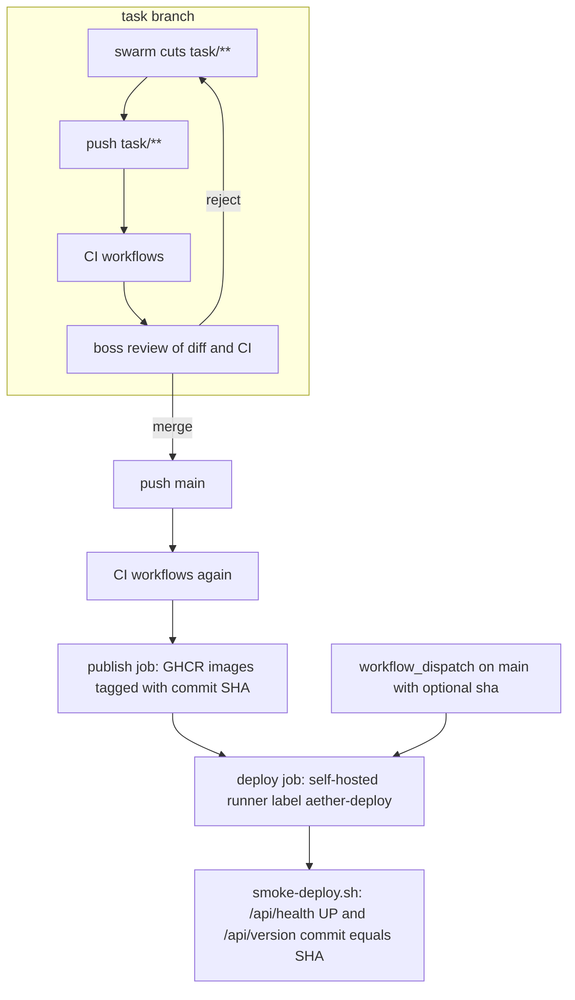

# CI/CD

This document describes the workflow files in `.github/workflows/` and the deploy scripts they call. A file in the tree is the design of the check. It is not a claim that a particular Actions run passed. Open the Actions log for a run before saying it was green.

`README.md` still says `ci-integration.yml`, `ci-e2e.yml`, and `cd.yml` are absent. That sentence is behind the tree. Those three files are on `main`. Trust the files named here, not that README paragraph.

`docs/contracts/00-stack-and-layout.md` says a task is accepted only when CI on its `task/<id>` branch is green. That is the project rule. This document does not grade a branch.

## Branch flow

Workers push `task/**` branches (this checkout is `task/t261119-0153-c582`). A push to `main` or `task/**` starts the CI workflows below, except where a path filter skips them. A pull request targeting `main` also starts those CI workflows. It does not start `cd.yml`.

Review is not a job in the YAML. `boss/PROMPT.md` section 8 says a finished task is reviewed against the contracts and the CI run, then merged or rejected. Merge to `main` is what starts publish and deploy.



CI on a `task/**` push does not publish images. `cd.yml` is triggered by that push, but its `publish` and `deploy` jobs are gated to `main`. Details are in the CD section.

Markdown and `docs/**` pushes are ignored by most workflows (`paths-ignore`). A docs-only commit, including this file, does not by itself run Java, integration, image, compose, or CD.

## Workflows

Shared pins, unless a row says otherwise: `actions/checkout@v7`, Java Temurin 21 (`actions/setup-java@v6`), Gradle via `gradle/actions/setup-gradle@v6`, Node 22 (`actions/setup-node@v7`). Runners for CI jobs are `ubuntu-latest`.

| Workflow | Trigger | Jobs | What it proves | Artifacts |
|---|---|---|---|---|
| `ci-java` | `push` to `main` and `task/**`, `paths-ignore` `swarm/**`, `boss/**`, `docs/**`, `**/*.md`. `pull_request` to `main` (no path filter). | `java`, timeout 25 min. `permissions: contents: read`. | `./gradlew build`: compile and unit-test every module. `:tests:test` excludes tag `integration`, so this does not start Testcontainers. | `java-test-reports` from `**/build/reports/tests/`, uploaded `if: always()`, ignore if missing. |
| `ci-web` | `push` to `main` and `task/**` only when paths include `web/**` or this workflow file. `pull_request` to `main` (no path filter). | `web`, working directory `web`. No `permissions` block. No timeout. | `npm ci`, `npm run lint`, `npm run test` (Vitest), `npm run build`. | `web-dist` from `web/dist`. Upload is not `if: always()`, so a failed test uploads nothing. |
| `ci-integration` | Same trigger and `paths-ignore` as `ci-java`. | `integration`, timeout 30 min. `permissions: contents: read`. | `./gradlew :tests:integrationTest`. Docker on the runner. See `docs/testing.md`. | `integration-test-reports` from `tests/build/reports` and `tests/build/test-results`, `if: always()`, ignore if missing. |
| `ci-compose` | Same trigger and `paths-ignore` as `ci-java`. | `compose`, timeout 30 min. No `permissions` block. `GIT_SHA` is `github.sha`. | `docker compose up -d --build`, then `bash infra/scripts/smoke.sh`, then status and logs, then `docker compose down -v` always. Proves the stack becomes healthy and the smoke checks in that script pass. Does not run `demo-e2e.sh`. | None uploaded. Logs are printed in the `Logs` step. |
| `ci-images` | Same trigger and `paths-ignore` as `ci-java`. | `images`, timeout 30 min. `permissions: contents: read`. | Builds `infra/docker/engine.Dockerfile`, `simulator.Dockerfile`, `control-api.Dockerfile`, and `web.Dockerfile` with `push: false`, tags `aether/engine:ci`, `aether/simulator:ci`, `aether/control-api:ci`, `aether/web:ci`. Web image is built only if `web/package.json` exists. Java images must run `java -version`. Each Java image's label `org.opencontainers.image.revision` must equal `GITHUB_SHA`. Web image must run `nginx -v`. Nothing is pushed. | None. Build cache is `type=gha`. |
| `ci-mock` | `push` to `main` and `task/**`, and `pull_request` to `main`. No path filter. | `mock`, timeout 10 min. No `permissions` block. No concurrency group. | `cd web/mock && npm install && node smoke.mjs`. Dev mock server only. | None. |
| `ci-e2e` | Same trigger and `paths-ignore` as `ci-java`, plus `workflow_dispatch`. | `lint`, then `e2e`. `permissions: contents: read`. | `lint` installs ShellCheck and lints `infra/scripts/demo-e2e.sh`. That job is blocking. `e2e` (timeout 30 min) sets `GIT_SHA` and `EXPECT_SHA` to `github.sha`, runs `docker compose up -d --build`, then `bash infra/scripts/demo-e2e.sh`, uploads logs, and always tears the stack down. | `compose-logs-<run_id>-<run_attempt>` from `compose-logs.txt`, `if: always()`, warn if missing. |
| `cd` | `push` to `main` and `task/**` with the same `paths-ignore`. `workflow_dispatch` with optional input `sha`. No `pull_request`. | `lint-cd`, `publish`, `deploy`. Workflow `permissions: contents: read`. | See the CD section. `lint-cd` always runs: actionlint, `bash -n`, and ShellCheck on `infra/deploy/deploy.sh` and `infra/deploy/smoke-deploy.sh`. | Images in GHCR, not Actions artifacts. No test-report upload. |

`ci-e2e` job `e2e` is `continue-on-error: true`. The file comment says this is temporary until the full backend is green on `main`. A green `ci-e2e` workflow check can hide a failed demo. Read the `e2e` job, not only the workflow conclusion. Job `lint` is not marked continue-on-error.

## Path filters and concurrency

Path filters on `push` keep swarm notes, boss notes, and markdown from rebuilding Java, images, and Compose. They are not on `pull_request`, except `ci-web`, whose `push` filter is a positive `paths` list and whose `pull_request` trigger has no filter. `ci-mock` has no path filter on either event. A pull request that only changes docs still runs `ci-java`, `ci-integration`, `ci-compose`, `ci-images`, and `ci-e2e`.

| Workflow | Concurrency group | Cancel in progress |
|---|---|---|
| `ci-java`, `ci-web`, `ci-integration`, `ci-images`, `ci-e2e` | `<workflow name>-<github.ref>` | yes |
| `ci-compose` | `ci-compose-<github.ref>` | yes |
| `ci-mock` | none | a second push does not cancel the first |
| `cd` (workflow) | `cd-<github.ref>` | yes only when the ref is not `refs/heads/main` |
| `cd` job `deploy` | `deploy` | no |

A new push to a task branch cancels the older CI run for that ref. A new push to `main` does not cancel an in-flight `cd` workflow, and the deploy job never cancels another deploy. Two deploys still cannot run at once (`group: deploy`).

## CD pipeline

`publish` runs only when `github.event_name == 'push'` and `github.ref == 'refs/heads/main'`. It logs in to `ghcr.io` with `github.actor` and `secrets.GITHUB_TOKEN`. Job permissions add `packages: write`. It pushes four images, each with the full commit SHA and a `main` tag:

- `ghcr.io/vivektiwary-25/aetherstream-engine`
- `ghcr.io/vivektiwary-25/aetherstream-simulator`
- `ghcr.io/vivektiwary-25/aetherstream-control-api`
- `ghcr.io/vivektiwary-25/aetherstream-web`

Build args: `GIT_SHA` for the three Java images, `VITE_GIT_SHA` for web. `provenance: false`. The floating tag is `main`, not `latest`. Deploy does not use the `main` tag.

`deploy` needs `publish`. It runs only when all of these hold:

- `github.repository == 'VivekTiwary-25/AetherStream'`
- `github.ref == 'refs/heads/main'`
- `publish` succeeded, or this run is `workflow_dispatch` and `publish` was skipped

Runner: `[self-hosted, aether-deploy]`. `.github/actionlint.yaml` lists that label so actionlint accepts it. Job permissions are `contents: read` only. The shell is Git Bash at `C:/Users/Arena/AppData/Local/Programs/Git/bin/bash.exe`. `DEPLOY_SHA` is `inputs.sha` if set, otherwise `github.sha`.

The job runs `bash infra/deploy/deploy.sh "$DEPLOY_SHA"`, then `bash infra/deploy/smoke-deploy.sh "$DEPLOY_SHA"`. On failure it prints the last 200 lines of `docker compose -p aether -f docker-compose.yml -f infra/deploy/docker-compose.deploy.yml logs`.

`infra/deploy/deploy.sh` requires one argument matching `[[:xdigit:]]{7,64}`. It exports `AETHER_TAG` and pulls with:

```text
docker compose -p aether -f docker-compose.yml -f infra/deploy/docker-compose.deploy.yml
```

`infra/deploy/docker-compose.deploy.yml` sets `image: ghcr.io/vivektiwary-25/aetherstream-<component>:${AETHER_TAG}` and `pull_policy: always` on coordinator, worker-1, worker-2, worker-3, simulator, control-api, and web. The tag is the SHA passed in, not `main`. After a healthy `up`, the script writes that SHA to `infra/deploy/.last-deployed`. That file is local runtime state. It is not a git commit.

`infra/deploy/smoke-deploy.sh` polls `http://localhost:8088/api/health` and `http://localhost:8088/api/version` for 120 seconds. Pass means the health body contains `"status": "UP"` and the version body contains `"commit": "<expected sha>"`. Port 8088 is nginx in `docker-compose.yml`. The control API is also published on host port 18080; the deploy smoke does not use 18080. A health check alone would pass on an old container. The commit check is what ties the running API to the SHA that was pulled.

`infra/deploy/README.md` is the operator note: the runner needs Git Bash, Docker Desktop with Compose, and a checkout. Public GHCR packages can be pulled without a token. The script prints the package-visibility hint if a pull is denied. Do not add registry credentials to the repo.

A push to `task/**` still starts `cd` (unless the path filter skips it) and runs `lint-cd`. `publish` is skipped. `deploy` does not run, because the ref is not `main` and the event is not `workflow_dispatch`.

## Security choices

- Deploy and publish do not run on `pull_request`. `cd.yml` has no `pull_request` trigger. A fork pull request cannot start this workflow.
- `publish` is a `push` to `main` only.
- `deploy` also requires `github.repository == 'VivekTiwary-25/AetherStream'`, so a fork's `main` does not deploy onto this runner even if someone copies the workflow.
- Workflow token starts at `contents: read`. Only the `publish` job adds `packages: write`. The deploy job does not get package write. Login uses `GITHUB_TOKEN`, not a personal access token in the file.
- Images are pulled by the commit SHA (`AETHER_TAG`), with `pull_policy: always`. The `main` tag is published as a moving alias. The deploy overlay does not reference it.
- `boss/PROMPT.md` requires the GitHub setting "Require approval for workflows from outside collaborators" (Settings > Actions). That setting is not a job, environment, or `if` in `cd.yml`. This document does not confirm the checkbox is on. Check it in the repository settings. The YAML gates above still apply if the checkbox is off.
- There is no `environment:` protection rule in the workflow files. Approval of a deploy is not an Actions environment reviewer.

`ci-web`, `ci-compose`, and `ci-mock` do not set `permissions`. The other CI workflows set `contents: read`. None of the CI workflows request `packages: write`.

## Rollback

Rollback is deploy of an earlier published SHA, not a retag of `main`.

From `main`, dispatch workflow `cd` and set input `sha` to the full commit that already has GHCR images. A blank input deploys `github.sha` (current `main`). `publish` is skipped on `workflow_dispatch`; `deploy` still runs because the `if` allows a skipped publish on that event.

Or, on the demo PC, from the repository root in Git Bash:

```bash
bash infra/deploy/deploy.sh <full-commit-sha>
bash infra/deploy/smoke-deploy.sh <full-commit-sha>
```

The SHA must already have all four images. `infra/deploy/README.md` states that. `.last-deployed` records the last successful local deploy and is not a rollback mechanism by itself.

Image rollback does not undo a Postgres migration and does not make an incompatible checkpoint readable. Pipeline version, protocol version, and image revision are separate. That is the design in `handoff.md` section 8 and `docs/architecture.md` section 9. There is no automated migration-down job in `cd.yml`.

Kubernetes and Terraform are not this pipeline. v1 deploy is Compose on the self-hosted runner.
