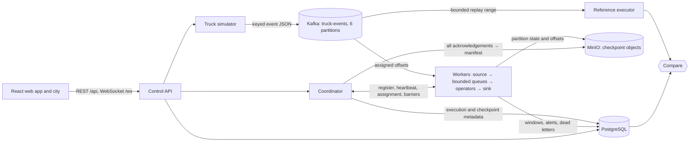

# AetherStream: Project Report for the CDD Expo

> **Project:** AetherStream  
> **Course:** Collaborative Development and DevOps (CDD)  
> **Student/team:** [complete with the project team's verified names]  
> **Institution:** [complete]  
> **Supervisor:** [complete]  
> **Submission date:** 21 November 2026
>
> This report distinguishes repository specifications, implementation evidence, and recorded run evidence. Replace the identity fields only with confirmed details. A workflow definition is not evidence that a run passed.

## Abstract

AetherStream is an educational stream-processing project built around a simulated urban delivery fleet. A Java simulator produces truck-position and delivery events; Kafka transports the events; a coordinator assigns source partitions to workers; workers execute keyed event-time pipelines and write results to PostgreSQL. MinIO stores worker checkpoint objects and manifests. A Spring-based control API and a React interface expose pipeline authoring, execution state, operational results, and event context. The runtime is designed to make delayed and duplicate events, bounded-queue backpressure, checkpoints, and worker recovery observable.

The implementation shares pipeline operator semantics between the distributed engine and a deterministic reference executor. This enables scoped comparisons at completed checkpoint boundaries. The repository also contains unit, integration, browser-component, mock-server, Compose, Kubernetes, Terraform, and benchmark checks. These are not interchangeable: a unit test can prove a state transition using fakes, whereas a passing distributed integration run exercises real Kafka, PostgreSQL, MinIO, and workers. Recorded Actions evidence includes an integration result comparing 811 reference and engine outputs, and separate Kubernetes and Terraform runs; the report links these records rather than presenting test assertions as measured service performance.

The project is an educational single-coordinator baseline, not a claim of a production-grade general-purpose engine. The normative contracts define six-partition input, per-partition watermarks, aligned checkpoints, and generation fencing. Savepoint and controlled-rescale APIs are additional repository features beyond the checkpoint baseline described in the protocol contract. Operational high availability, general online repartitioning, authenticated multi-tenant use, measured production capacity, and usability-study results are not claimed here.

## 1. Problem and goals

An event stream is not a clean sequence of perfectly timed, unique records. A truck may emit a record late, a producer may resend an event, a payload may violate its schema, a sink may slow down, or a worker may disappear while holding state. A processing application must state what each case means. It must also ensure that the data already written agrees with the input positions and operator state selected for recovery. A dashboard that only displays a moving map or a green status indicator cannot demonstrate those properties.

AetherStream frames this challenge as a bounded logistics example. The simulator describes a 2,000-by-2,000-metre city, with a depot and seeded delivery stops. It generates position and delivery events with a stable truck key, simulation event time, schema version, event identifier, and typed payload. A configurable stuck-truck scenario generates a sequence useful for demonstrating a rule. The simulator's HTTP API also exposes deliberate late, duplicate, and malformed event injection; these are controlled demonstrations of data-quality and time semantics, not claims about a real commercial fleet. See [event and simulator contract](../contracts/01-event-envelope-and-simulator.md).

The project goals are:

1. Define a versioned event and pipeline contract, and reject invalid pipeline graphs with actionable compiler errors.
2. Make event-time window, duplicate, late-record, and alert behaviour deterministic and testable.
3. Distribute work by Kafka partition while bounding queues so a slow sink applies backpressure rather than requiring unbounded buffering.
4. Capture state and source positions at a consistent checkpoint boundary, and use completed checkpoints with generation fencing during recovery.
5. Compare engine output with a reference implementation over a clearly bounded Kafka offset range.
6. Present system activity through a city visualisation and readable operational/editor panels, and automate repeatable checks through CI.

These are engineering goals; section 4 scopes the evidence and section 8 links recorded runs. Repository examples do not establish throughput, universal exactly-once delivery, coordinator high availability, or usability outcomes.

## 2. Architecture

The runtime path begins with simulator events keyed by `truckId`. Kafka's `truck-events` topic has six partitions and uses the same key, so the v1 supported `keyBy` fields correspond to the existing Kafka partition key; the pipeline does not need a repartitioning stage. The coordinator controls worker assignment, checkpoints, recovery and execution generations. Workers consume assigned partition records and pass them through a bounded source/operator/sink pipeline. PostgreSQL stores executions, checkpoint metadata, windows, alerts, and dead letters; MinIO stores checkpoint state files and manifests. The control API joins operator-facing requests to the coordinator, simulator and stored results. The web app uses same-origin `/api` and `/ws` routes through the web server.

The diagram is a high-level project view; see the separate [architecture document](../architecture.md) for its own treatment. The normative component boundaries, ports and pinned versions are recorded in [stack contract](../contracts/00-stack-and-layout.md); the wire format and event rules are in [event contract](../contracts/01-event-envelope-and-simulator.md). The core Gradle modules are `:common` for shared records, `:compiler` for graph validation and operator semantics, `:reference` for single-process replay, `:engine` for coordinator and worker runtime, `:control-api`, `:simulator`, and `:tests`. `web/` is a Vite/React/TypeScript application.

The principal data boundary is a Kafka record containing a JSON envelope with `eventId`, `schemaVersion`, `type`, `eventTime`, `key`, and `payload`; the engine adds source topic, partition, and offset in memory. Invalid envelopes are rejected to the dead-letter output rather than entering normal operators. The compiler validates a directed acyclic graph of source, filters/maps, key-by, windows, rules, and sinks, then produces a deterministic plan. The full REST and WebSocket boundary is documented in [control API contract](../contracts/04-control-api-rest-ws.md). The demo pipeline illustrates parallel speed and delivery paths, keyed tumbling windows, a stuck-truck rule and PostgreSQL sinks.

## 3. Engine design

### Partitioning and event time

The input topic has six partitions and is keyed by truck. The coordinator assigns partitions round-robin among live workers sorted by worker ID. A worker executes a `PartitionPipeline` for each assigned partition. Processing is in per-partition Kafka offset order. This makes the partition the unit of ordering, watermark progress, snapshot state and recovery position; results do not depend on cross-partition interleaving or which worker currently owns a partition.

The demo uses one-minute tumbling windows. A record with event time `t` is assigned to `[floor(t / size) * size, start + size)` for its key. Each partition and window operator maintains the maximum timestamp observed, `maxTs`. Its watermark is `maxTs - outOfOrdernessMs`; for the demo's five-second allowance, a window fires when its end is at or behind that watermark. The watermark is evaluated before the incoming record for the late check. An event targeting an already-closed window is emitted once as a `LATE` dead letter and is not added to the window. Distinct event IDs are counted at most once per key-window; duplicates still inside an open window are ignored without a dead letter. A partition with no new input does not advance: idle windows remain open under the declared policy. These details are normative in [pipeline semantics](../contracts/02-pipeline-and-semantics.md).

The window operator supports count, sum, average, minimum and maximum. Aggregation fields absent on a record are skipped, while count counts the accepted record. Window firing order is deterministic. A rule tracks consecutive qualifying results per key and emits an alert when the configured streak is reached; a gap or failed result resets that streak. The demo stuck-truck rule looks for low average speed across ten consecutive one-minute windows. The compiler's shared operator code is also called by the reference executor, reducing the risk of separately implemented definitions of the same operation.

### Backpressure and checkpoints

Each worker has a source thread, a bounded queue of capacity 1,000, an operator thread, a second bounded queue of capacity 1,000, and a sink thread. Queue saturation blocks the upstream stage and is surfaced as backpressure. The sink batches PostgreSQL writes. This is a bounded memory and flow-control design, not an assertion that a particular throughput or latency has been achieved.

For a checkpoint, the coordinator creates a pending checkpoint and sends a trigger. Each worker's source records the next offset not yet enqueued and places a barrier behind records already in the source queue. The operator snapshots each partition's state at the barrier and forwards it. The sink flushes and commits preceding output before uploading the worker's partition states and next offsets to MinIO and acknowledging the coordinator. The coordinator waits for acknowledgements covering all partitions, writes a manifest, and only after that upload succeeds marks the checkpoint `COMPLETED`. A checkpoint that times out or is interrupted is aborted; its partial worker objects are not a recovery point. Checkpoint zero records initial beginning or end offsets depending on the pipeline's start mode.

Recovery selects only the latest completed checkpoint. It restores the matching partition state and offsets, seeks Kafka to the saved positions, and replays from there. The coordinator increments the execution generation before reassignment. Sink transactions lock and check the execution generation before writing, so a stale worker cannot commit after a newer generation is active. Output rows are upserted by their logical keys. The contract therefore describes at-least-once input replay, state restored with offsets from one consistent checkpoint, and effectively exactly-once PostgreSQL results through deterministic output and upsert keys. It makes no such exactly-once claim for other sinks. The full protocol is [coordinator/worker contract](../contracts/03-coordinator-worker-protocol.md).

### Savepoints and rescale

The repository [README](../../README.md) lists APIs for creating and restoring savepoints, including rejection of an incompatible savepoint, and for controlled rescaling. It characterises rescale as a pause at a completed checkpoint followed by reassignment, not online migration, and says a balanced assignment is refused. These additions must be understood alongside the contracts: contract 03 specifies periodic checkpoints, recovery, and generation fencing but does not define savepoint or rescale request/restore semantics. This report treats them as repository extensions, not behaviour guaranteed by the normative worker protocol. A future contract revision should describe compatibility checks, lifecycle and rescale invariants before treating those interfaces as stable.

## 4. Correctness and verification

The reference executor is a deterministic single-process baseline. It replays the same shared `PartitionPipeline` semantics, in partition offset order. The compare API uses the initial checkpoint and latest completed checkpoint as Kafka offset bounds; it compares reference windows against PostgreSQL rows, including event count and aggregation values within absolute tolerance `1e-6`, and checks for extra closed-window rows. It returns a bounded mismatch list. Thus “match” refers to this replay range and result scope; it is not a proof for arbitrary future inputs, every possible failure, or sinks outside PostgreSQL.

The following test names in [testing guide](../testing.md) establish distinct evidence:

| Test or test family | What the assertion demonstrates | Boundary |
|---|---|---|
| `PipelineCompilerTest` | Invalid graphs report contract error codes, node context and repair hints; multiple independent errors are collected; the demo plan is deterministic and round-trips. | Compiler unit test; no workers start. |
| `PartitionPipelineTest.snapshotRoundTripsMatchUninterruptedExecutionAcrossFiveThousandRecords` | Snapshot/restore at three cuts over a 5,000-record deterministic stream preserves windows, alerts, dead letters and maximum timestamp. Other methods exercise duplicates, late checks, ordering and rule streaks. | Shared operator unit test, not a distributed checkpoint. |
| `SimulationTest.seed42IsByteIdenticalForThirtyMinutesAndTheSameApiCalls` | Two seeded simulations produce identical emissions for the same API call sequence. | Simulator unit test, not Kafka delivery. |
| `CoordinatorTest.checkpointCompletesOnlyWhenAllPartitionsAckedAndManifestIsWrittenFirst` | A checkpoint remains pending until all partitions acknowledge, and manifest creation precedes completion. | In-memory repositories and checkpoint store. |
| `CoordinatorTest.workerFailureRecoversFromLastCompletedCheckpointWithNewGeneration` and `incompleteCheckpointIsNeverChosenForRecovery` | Recovery uses a completed checkpoint and a new generation, rather than a partial checkpoint. | Coordinator unit tests with fakes. |
| `TaskRuntimeTest.sinkDelayFillsQueuesAndBlocksSource` | Slow sink fills bounded queues, exposes backpressure and bounds emitted work. | Fake source/sink runtime test; not a latency benchmark. |
| `WorkerAdaptersIT.postgresSinkRejectsStaleGenerationWithoutInsertingOrOverwritingRows` | A real PostgreSQL sink refuses a stale generation without mutating rows. | Testcontainers integration test. |
| `EngineMatchesReferenceIT.engineMatchesReferenceAtCompletedCheckpoint` | A multi-worker Kafka/PostgreSQL/MinIO execution compares with replay at a completed checkpoint and checks alerts and dead-letter categories. | Distributed Testcontainers integration test. |
| `WorkerCrashRecoveryIT.workerCrashRestoresCompletedCheckpointAndMatchesReference` | A worker crash scenario restores from a completed checkpoint and checks the resulting comparison. | Testcontainers integration test; not an actual Compose deployment. |
| `IncompleteCheckpointIT.abortsInterruptedCheckpointAndRestoresPreviousCompletedManifest` | An interrupted checkpoint is aborted and recovery selects the previous completed manifest. | Testcontainers integration test with real stores. |

The repository records a specific integration workflow run, [Actions run 44395770221](https://github.com/VivekTiwary-25/AetherStream/actions/runs/44395770221), whose log reported 811 reference results, 811 engine results, 811 matched, and equal dead-letter counts of 25 and 25. That is evidence about that run, not an invariant count or benchmark. The report does not infer successful operation from test names alone. Unit tests use fakes where indicated; integration tests use Testcontainers; CI artifacts and logs are needed to establish the outcome of a particular run.

The UI also has Vitest coverage for dashboard reducer states, backpressured/dead worker labels, recovery checkpoint labels, confirmation before worker-kill requests, compare rendering, editor validation feedback, and city mapping logic. The mock-server smoke check is separate from the simulator and from live-engine correctness. There is no basis here to treat a component test as a full browser end-to-end test or as proof that a user completed a task.

## 5. UI and user experience

The interface uses the logistics city as visual context: trucks, the depot and stops make the source workload legible. The city is not the authoritative place to inspect exact operational values. The dashboard pairs it with panels for speed windows, delivery rates, alerts, dead letters, workers and execution status. This reflects the design rationale in [UX design thinking](../ux/design-thinking.md): a city-only display risks hiding exact data and engine state, while a metrics-only dashboard loses the relationship to the simulated workload. The proposed direction combines the scene with glass-like panels and readable data views.

The pipeline editor represents a graph of typed operators and provides configuration and compiler feedback. The chaos surface exposes late/duplicate/malformed input, sink delay and worker-kill operations; such actions affect runtime state and are demonstration controls, not routine production controls. The compare surface is intended to show result counts and mismatches within the contract's checkpoint scope. The checkpoint timeline and scenario chooser are other named interface components. The availability of a component in source does not by itself mean it is mounted or reachable in the active shell; the live shell and workflow should be checked for the actual presentation build before making an expo claim.

Glass-panel styling is a visual grouping choice, not evidence of measured contrast. The UX documents favour readable labels alongside state colour, preserve a table-oriented view for exact values, distinguish running from backpressured and recovering states, and call for reduced-motion handling. They explicitly state that personas and journeys are assumptions, not interview findings, and that the usability activities are proposed rather than completed. The screenshot set documents deployed dashboard captures on 19 November 2026; it does not cover every newer panel. No participant study, SUS score, WCAG conformance result, or accessibility audit is claimed. See [UX overview](../ux/README.md), [usability decisions](../ux/usability-decisions.md), [design system](../ux/design-system.md), and [visual QA](../ux/visual-qa.md).

The product boundary is documented by [API contract 04](../contracts/04-control-api-rest-ws.md): REST endpoints serve pipeline validation, executions, results and chaos actions; the plain WebSocket carries snapshots and periodic state updates. It requires text and colour together for execution states. The web client can therefore communicate system state with explicit language, while the city remains an orientation layer.

## 6. DevOps and delivery

### Build and local environment

The pinned stack is Java 21 and Gradle 9.6, with Kafka 4.3.2, PostgreSQL 17, S3-compatible MinIO, Spring Boot for the control API, and Node 22/React/TypeScript/Vite for the web application; exact versions are in [stack contract](../contracts/00-stack-and-layout.md) and the Gradle catalog. `docker-compose.yml` defines Kafka, PostgreSQL, MinIO, coordinator, three worker services, simulator, control API and web. The Compose smoke script checks the dependencies and service endpoints, topic and bucket setup, registered workers, simulator state and input activity. Local development credentials are defaults, not credentials for an exposed deployment.

Custom Dockerfiles in `infra/docker/` build engine, simulator, control API and web images. The CI image workflow checks image entry points and revision labels, but its builds use `push: false`; they are not publications. The separate `cd.yml` publishes four GHCR images on pushes to `main`, tagged by commit SHA and `main`, then deploys the requested SHA using the `aether-deploy` self-hosted runner. Its deployment smoke checks both API health and `/api/version` commit identity. `task/**` pushes run the lint job but do not publish or deploy. Workflow definitions and deployment scripts are evidence of configured behaviour, not proof that the runner is online or a deployment succeeded.

### CI, Kubernetes, Terraform and monitoring

GitHub Actions workflows separate Java build/unit tests, web lint/tests/build, Testcontainers integration tests, Compose smoke, image checks, mock-server smoke, full-system demo, Kubernetes, Terraform and benchmark checks. `.github/workflows/ci-mock.yml` runs `cd web/mock && npm install && node smoke.mjs`; it exercises the development mock server only. The Java and integration jobs upload reports, while run conclusions must be read from the run corresponding to the commit being presented.

The repository contains a Kubernetes/kind path in `infra/kubernetes/` and `.github/workflows/ci-k8s.yml`. Its README describes rendering and schema validation before applying resources, then readiness checks and worker-pod deletion/recovery in CI. This is a single-node development baseline; its own guide says it is not HA or internet-facing production. `infra/terraform/` provides a parallel local Docker-backed environment, with a workflow that formats, validates, applies, checks readiness and destroys the resources. These deployment paths complement rather than replace the default Compose demo.

The optional Compose monitoring profile provisions Prometheus and Grafana in `infra/monitoring/`. Its documentation describes coordinator and control-api metrics scraping and a dashboard for workers, generations, checkpoints, recovery, throughput, queue size and backpressure. Metrics may be absent until instrumentation is exposed. This is an observability setup, not an independent performance report. Recorded repository evidence includes [Kubernetes run 44398295492](https://github.com/VivekTiwary-25/AetherStream/actions/runs/44398295492), whose job log reports recovery from a checkpoint with a higher generation within its 60-second assertion, and [Terraform run 44395471523](https://github.com/VivekTiwary-25/AetherStream/actions/runs/44395471523), whose log records 24 resources created and later destroyed. The recovery statement is the test's deadline assertion, not a measured recovery duration.

## 7. Team and process

The repository divides responsibility by lanes: contracts/common records, compiler/reference, engine, simulator, web city, web application, infrastructure, and tests, as shown in the stack and layout contract. This separation gives parallel work a shared vocabulary: wire formats, operator semantics, worker protocol, API schemas and module dependencies are written down before consumers implement their parts. Contract 00 assigns ownership for modules and lists independent CI workflows so that concerns can be checked separately.

The documented process uses `task/**` branches and CI on task pushes, followed by review against contracts and CI before merge to `main`; the gated publication and deployment workflow then runs on main. This is process documentation, not proof of branch protections, every review, or this task's outcome. Lane labels do not establish team membership; complete the title-page roster with verified names. Deterministic shared semantics and explicit JSON/API contracts provide a common interface, while only a green run on the presented commit establishes a CI result.

## 8. Results and evidence

Results must be read with their evidence class. Source contracts establish intended semantics; test assertions establish a reproducible check; a workflow log establishes a recorded run; runtime counters and benchmark artifacts establish measured observations only for their recorded workload and environment. The following are repository-verifiable statements and recorded-run links:

- The normative demo pipeline uses six Kafka partitions, 60,000 ms tumbling windows and 5,000 ms out-of-orderness, with speed/delivery aggregations and a ten-window stuck-truck rule ([contract 02](../contracts/02-pipeline-and-semantics.md)).
- Worker queues are specified at capacity 1,000 each, and the TaskRuntime test asserts saturation and upstream blocking under a delayed fake sink ([contract 03](../contracts/03-coordinator-worker-protocol.md); [testing guide](../testing.md)).
- `PartitionPipelineTest` includes a deterministic 5,000-record interrupted-versus-uninterrupted snapshot equivalence assertion; it is not a distributed checkpoint measurement.
- The recorded integration run [44395770221](https://github.com/VivekTiwary-25/AetherStream/actions/runs/44395770221) logged 811 reference rows and 811 engine rows matched, plus equal dead-letter counts. These figures describe that log only.
- The recorded Kubernetes run [44398295492](https://github.com/VivekTiwary-25/AetherStream/actions/runs/44398295492) includes the recovery assertion and pod diagnostics. Its 60 seconds is an upper bound in the test, not the observed elapsed time.
- The recorded Terraform run [44395471523](https://github.com/VivekTiwary-25/AetherStream/actions/runs/44395471523) logged 24 resources added and destroyed.
- The repo defines benchmark tooling and workflows, but this report supplies no benchmark throughput or latency values. It also supplies no recovery-duration statistic, participant usability score, or general production capacity figure.
Internal Markdown links were checked against this checkout by opening cited files or confirming directory-listed paths.

For an expo presentation, verify each linked workflow's commit SHA, conclusion, job logs and artifacts before presenting its result. The [CI/CD guide](../ci-cd.md) explains workflow triggers and what each job proves; [testing guide](../testing.md) maps test names to their boundaries. A green mock workflow does not prove Kafka processing, and a green smoke test does not establish that recovery and reference comparison passed. Results from a full-system demo should be taken from its own job log rather than inferred from the workflow file.

## 9. Limitations and future work

The coordinator design is single-active-instance. The contracts describe membership and recovery, but not a replicated coordinator or durable leader election. A coordinator outage and multi-coordinator split-brain safety are therefore outside the availability claim. The input design uses six fixed partitions and key-by fields that match the Kafka key; it does not support arbitrary repartitioning. Per-partition watermarks also leave windows open for partitions that become idle. That policy is explicit and simple, but future work could define idle-partition advancement without invalidating late-event guarantees.

The current correctness claim is scoped to replay from completed checkpoint offsets and PostgreSQL's deterministic upsert behaviour. Other sinks are not included in the exactly-once statement. Integration coverage uses Testcontainers and in-process workers in some cases; a test that throws on a kill command is not a crashed operating-system process. The crash recovery integration test improves on the unit-level fake, but failure models should be read from the individual test setup. The controlled rescale interface is not online migration, and the savepoint/rescale APIs are not fully specified in the normative contracts.

Security and production operations need more work before deployment beyond a controlled demonstration. Development credentials are present as defaults; Kubernetes documentation warns that example credentials are public. The repository should not be presented as internet-facing, authenticated multi-tenant software. The educational Kubernetes setup is single-node, Terraform targets local Docker, and the Compose deployment depends on the configured self-hosted runner. CI/CD configuration does not in itself establish a protected runner, disaster recovery, secrets hygiene in a production environment, or operational service-level objectives.

The UX documents present rationale and proposed research rather than completed user research. The live screenshot set does not show every editor, chaos, comparison, or timeline surface. Keyboard, screen-reader, contrast, and reduced-motion behaviour require rendered-surface validation; no conformance certification is claimed. Future work can test complete operator workflows with participants and record measured outcomes, while keeping the map supplemental to accessible tables and text labels.

Finally, no performance benchmark result is asserted here. A defensible capacity study would need a defined workload, input rate, cluster resources, duration, warmup, queue and checkpoint observations, latency percentiles and repeatable run artifacts. Additional work should also bring savepoint and rescale semantics into the contracts, expand failures tested against real services, and make CI evidence for a demonstrated commit easy to retrieve. These limits do not negate the value of the verified components; they set the boundary for claims an examiner can reproduce.

## References

1. [AetherStream contracts](../contracts/README.md), especially [stack and layout](../contracts/00-stack-and-layout.md), [event envelope and simulator](../contracts/01-event-envelope-and-simulator.md), [pipeline semantics](../contracts/02-pipeline-and-semantics.md), [coordinator/worker protocol](../contracts/03-coordinator-worker-protocol.md), and [control API](../contracts/04-control-api-rest-ws.md).
2. [Testing guide](../testing.md), [CI/CD guide](../ci-cd.md), and [UX documentation](../ux/README.md).
3. [Integration Actions run 44395770221](https://github.com/VivekTiwary-25/AetherStream/actions/runs/44395770221), [Kubernetes Actions run 44398295492](https://github.com/VivekTiwary-25/AetherStream/actions/runs/44398295492), and [Terraform Actions run 44395471523](https://github.com/VivekTiwary-25/AetherStream/actions/runs/44395471523).
4. Apache Flink, [Project overview](https://flink.apache.org/), for general stream-processing background only; AetherStream does not run on Flink.
