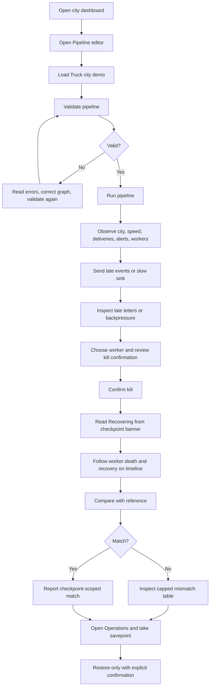

# Low-fidelity wireframes

These hand-made SVGs explore the information hierarchy and demo path using the implemented `web/src/app/` components as their source. White canvases and dark text keep labels legible in either GitHub theme; these are planning wireframes, not pixel-accurate captures.

- [01 — City dashboard](01-city-dashboard.svg): explores how the city can orient the presenter without displacing engine state or inspectable results. The final `AppShell.tsx` and `LivePanels.tsx` use a dark city view, responsive bento panels, a distinct execution banner, and a deployed-version footer rather than this grayscale concept; deployed references are [desktop screenshot](../screenshots/desktop-01-app-viewport-60s.png) and [mobile screenshot](../screenshots/mobile-01-app-viewport-60s.png).
- [02 — Pipeline editor](02-pipeline-editor.svg): explores authoring while keeping operators, graph, selected-node configuration, validation errors, and separate Validate/Run actions in view. `PipelineEditor.tsx`, `BlockPalette.tsx`, `ConfigInspector.tsx`, and `ValidationList.tsx` implement these roles in a full-screen modal graph editor; unlike this schematic, the final editor uses interactive graph controls and configuration fields. The editor was added after the screenshots in `docs/ux/screenshots/`, so there is no final UI capture to compare.
- [03 — Chaos and recovery](03-chaos-and-recovery.svg): explores safe fault injection and making recovery evidence persist after the transient event. `ChaosPanel.tsx` has late/duplicate/malformed controls, sink delay and worker-kill confirmation; `ExecutionBanner` in `LivePanels.tsx` and `CheckpointTimeline.tsx` expose recovery state and checkpoint history. The deployed screenshots [recovering](../screenshots/desktop-04-recovering-viewport.png) and [after recovery](../screenshots/desktop-06-after-recovery-fullpage.png) show the final dashboard's dark treatment and banner/timeline; the chaos confirmation itself was not captured.
- [04 — Reference comparison](04-compare.svg): explores trustworthy correctness evidence by placing checkpoint scope, action, match counts, and mismatch detail together. `ComparePanel.tsx` implements the comparison action, explanatory scope, result counts, and mismatch table; the sketch shows a representative result layout, while the final panel is a collapsible dashboard panel with conditional match or mismatch content. It was not mounted when the live screenshots were taken, so no final UI capture exists.
- [05 — Operations savepoint / restore](05-ops-savepoint-restore.svg): explores separating execution status from high-impact savepoint restore and making the restart consequence explicit. `OpsPanel.tsx` implements Take savepoint, recent savepoints, Restore, and a browser-native confirmation; the confirmation drawn here is an explanatory concept, not a custom dialog in the final UI. No corresponding final screenshot exists in `docs/ux/screenshots/`, which predates this panel.
- [06 — Mobile, 390 px](06-mobile-390.svg): explores a single-column reading order that keeps the city, recovery label, and key operational panels readable at narrow width. `AppShell.tsx` composes the city, banner, panels, and footer while responsive styling stacks the dashboard; the final app keeps its large city first and stacks dashboard panels rather than replacing them with the compact summaries sketched here. Compare with the [390×844 deployed capture](../screenshots/mobile-01-app-viewport-60s.png) and [mobile recovering capture](../screenshots/mobile-06-after-recovery-fullpage.png); the timeline and worker labels in this proposal reinforce status information when map detail is small.

## Presenter demo flow

